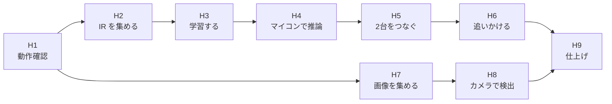

# ハンズオン：自分のロボットで 1 つずつ作る

理論 1 : 実装 9

## このハンズオンについて

本文（第0〜7部）で学んだことを、**自分のロボットの実機** で 1 つずつ形にしていく課題集です。1 人で、自分のペースで進めます。

- 全部で **9 回**。1 回はだいたい **90 分**（集める・待つ時間で前後します）
- 各回に **合格条件** があります。全部にチェックがついたら次の回へ進みます
- 細かい説明は本文のページにあります。ハンズオンのページは「何を、どの順番でやるか」と「できたかどうかの確かめ方」に集中しています
- 測った数字は **記録シート** に書いて、チーム用リポジトリに残します。次の回や大会前に見返すためです

| 回 | 作るもの | 本文 | 使う機材 |
|---|---|---|---|
| [H1](h1-check.md) | 開発環境と、センサの値が PC で見える状態 | 第0部、1-2、1-3 | センサ側マイコン、CoreS3 |
| [H2](h2-collect.md) | 自分のロボットの IR データ（取り直し 3 回分） | 1-4、1-5 | センサ側マイコン、ボール |
| [H3](h3-train.md) | 自分のデータで学習した BallNet と、その成績 | 第2部、第3部 | PC だけ |
| [H4](h4-on-device.md) | センサ側マイコンで動く BallNet | 第4部 | センサ側マイコン |
| [H5](h5-link.md) | センサ側 → CoreS3 の通信と、画面の表示 | 5-1〜5-3 | 両方、配線 |
| [H6](h6-chase.md) | ボールを追いかけるロボット | 5-5 | ロボット全体 |
| [H7](h7-images.md) | 自分で撮ってラベルを付けた画像 | 6-1〜6-4 | CoreS3、SD カード |
| [H8](h8-detect.md) | CoreS3 で動く物体検出 | 6-5〜6-8 | CoreS3 |
| [H9](h9-finish.md) | 「会場が変わっても使える」仕上げ | 6-9、第7部 | ロボット全体 |

H7・H8（カメラ）は、H1 が終わればいつでも始められます。IR と並行して進めてもかまいません。

---

## 始める前に

### チーム用リポジトリを用意する

[0-3](../part0-setup/github.md) の手順で、**非公開** のチーム用リポジトリを作っておきます。ハンズオンで作るデータ・モデル・記録は、全部そこに置きます。

記録シートのひな形は、チーム用リポジトリの `records/handson.md` に入っています（0-3 でコピーした `templates/team` に含まれています）。

!!! private "公開しないもの"
    センサの型番と個数、使うボール、センサ側のマイコン、集めたデータと画像、学習したモデル、調整した値（しきい値・ゲインなど）、記録シート。
    これらは教材のリポジトリ（公開）にはコミットしません。教材のリポジトリには `.gitignore` と公開チェックが入っていますが、**最後に守るのは自分** です。

### 機材

| 回 | 必要なもの |
|---|---|
| 全部 | PC、USB ケーブル（データ通信ができるもの） |
| H1〜H6 | IR センサリングをつないだセンサ側マイコン（Arduino または ESP32）、IR ボール |
| H1、H5〜H9 | M5Stack CoreS3 |
| H5、H6 | ジャンパー線、電圧をそろえる部品（5 V のマイコンを使うとき：抵抗 2 本か、レベル変換モジュール） |
| H6、H9 | モータ側のマイコンとモータドライバ、バッテリー、広い床（できればコート） |
| H2、H9 | 床に角度と距離の目印を付けるもの（マスキングテープ、分度器、メジャー） |
| H7〜H9 | microSD カード（FAT32）、黄色と青のゴール（なければ色紙で代用）、ほかのロボット |

!!! warning "安全のために"
    - 5 V のマイコン（Arduino Uno など）の TX を、3.3 V の CoreS3 にそのままつながない（5-1）
    - モータを回すときは、最初は **車輪を床から浮かせて** 試す。いつでも電源を切れるようにしておく
    - リポバッテリーは、充電中に目を離さない。ふくらんだものは使わない

### 進め方のコツ

- 各回の最初に「本文」の欄のページを読み直します。**全部わかっていなくてよい** ので、手順に出てくる言葉がわかる程度で十分です
- うまくいかないときは、各回の「困ったとき」と、本文の「つまずきポイント」を見ます
- 合格条件の数字は **目安** です。自分のロボットでどうしても届かないときは、原因と測った数字を記録シートに書いて、次へ進んでもかまいません。あとで戻ってきたときの手がかりになります
