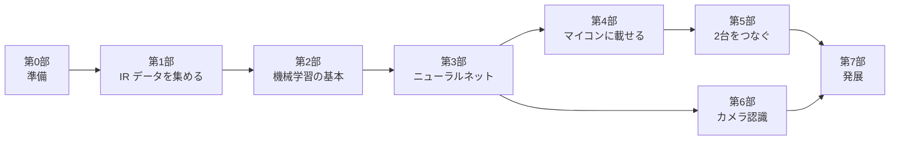

# RCJ Soccer 機械学習入門

ロボカップジュニア サッカー（赤外線）のロボットに **機械学習** を組み込めるようになるための教材です。
IR センサとカメラの 2 つの「目」でボール・ゴール・相手ロボットを見つけるモデルを作り、マイコンの上で動かすところまで進みます。

理論 3 : 実装 7　理論は図と短い式で直感をつかむ程度にして、手を動かす時間を多くとっています。

## この教材でできるようになること

- IR センサリングの値を集めて、**ボールの角度・距離・保持しているか** を推定するモデルを作る
- 作ったモデルを **Arduino / ESP32 / M5Stack CoreS3** の上で動かす
- センサ側のマイコンと CoreS3 を **UART でつなぎ**、推定結果でロボットを動かす
- CoreS3 のカメラで **ボール・黄ゴール・青ゴール・相手ロボット** を見つける
- IR とカメラの結果を合わせ、**会場での調整** や **追跡** までして試合で使えるようにする

## 全体の地図

| 部 | 内容 | ノートブック |
|---|---|---|
| [第0部 準備](part0-setup/index.md) | 教材の使い方、Python の環境、GitHub とチーム用リポジトリ、設定ファイル | `00_check_environment` |
| [第1部 IR データを集める](part1-ir-data/index.md) | IR ボールとセンサの仕組み、値を読む、PC に送る、正解ラベル、データを眺める | `01_ir_data` |
| [第2部 機械学習の基本](part2-ml-basics/index.md) | 従来の方法、線形回帰と勾配降下法、角度は輪っか、正しい評価、scikit-learn | `02_angle_estimation` |
| [第3部 ニューラルネット](part3-neural-net/index.md) | ニューロン、Keras で BallNet、過学習、保持の分類、データ拡張 | `03_neural_net` |
| [第4部 マイコンに載せる](part4-on-device/index.md) | C で動かす、メモリと速さ、量子化、TensorFlow Lite Micro | `04_on_device` |
| [第5部 2台をつなぐ](part5-two-boards/index.md) | 役割分担、パケット設計、CoreS3 に表示、データ収集、追いかけ制御 | `05_two_boards` |
| [第6部 カメラ認識](part6-camera/index.md) | 画素と色、HSV、画像の収集とラベル付け、CNN、物体検出、相手ロボット、IR との融合 | `06_camera` |
| [第7部 発展](part7-advanced/index.md) | 会場での追加学習、ボールがないときの判定、模倣学習、追跡と自己位置 | `07_advanced` |

## 読み方

- 本文は **中学生・高校生** が読めるように書いています。数学は高校の範囲まで、微分は図で説明します。
- 各ページは「ねらい → 理論 → 手を動かす → チェック問題 → つまずきポイント → もっと深く」の順に並んでいます。
- 各ページの最後にある **「もっと深く」** は、大学生レベルの補足です。飛ばしても先に進めます。
- 手を動かすところは **Colab（ブラウザだけ）** と **ローカル（自分の PC の VS Code + Jupyter）** の両方で動きます。各部のページにある「Open in Colab」のボタンから、その部のノートブックを開けます。

!!! tip "どこから始めるか"
    - **初めての人**：第0部から順に進めます。
    - **Python と機械学習は知っている人**：第0部で環境を作ったら、第1部 1-1（ボールとセンサの仕組み）を読んで、第3部へ進んでもかまいません。
    - **カメラだけやりたい人**：第0部と第3部 3-1〜3-2 のあと、第6部へ進めます。

## 実機がなくても進められます

IR センサリングの **シミュレータ** と、ボール・ゴール・ロボットが映った **画像のシミュレータ** を用意しています。
ロボットやセンサがなくても、データを作って学習し、マイコン用に書き出すところまでは全部できます。シミュレータは、反射・遮へい・外乱光・センサの個体差などを入れてあり、`easy`／`normal`／`hard` の 3 段階で難しさを変えられます。

実機がある人は、途中から自分のデータに差し替えます。本文の数字は、すべてシミュレータで実際に動かした結果です。自分のロボットでは数字が変わるので、必ず測り直してください。

## 自分のチームのデータは公開しない

!!! private "この教材のルール"
    自分の機体のセンサの型番や個数、使うボール、センサ側のマイコン、実機で取ったデータ、撮った画像、学習済みモデル、調整した値は、大会で戦うための大事な情報です。
    この教材では、**教材（このサイト）は公開**、**チームの情報は非公開リポジトリ** に分けて進めます。やり方は [0-3](part0-setup/github.md) と [0-4](part0-setup/config.md) で説明します。
    ほかのチームのロボットの画像は、**そのチームの許可をもらってから** 使い、非公開の場所だけに置きます。

## 使うもの

| 種類 | 必須 | あると実機で試せる |
|---|---|---|
| PC | Windows または Mac | |
| アカウント | Google（Colab 用）、GitHub | |
| マイコン | | Arduino（Uno など）または ESP32、M5Stack CoreS3 |
| センサ | | IR センサ（ボール検出用）を複数個 |
| ボール | | RCJ の IR ボール |

## ライセンス

教材の文章・コードは [MIT License](https://github.com/Asg1223/rcj-soccer-ml/blob/main/LICENSE) で公開しています。授業や部活、チームの練習で自由に使ってください。まちがいや分かりにくいところを見つけたら、GitHub の Issue で教えてもらえるとうれしいです。

まずは [第0部 準備](part0-setup/index.md) から始めましょう。
