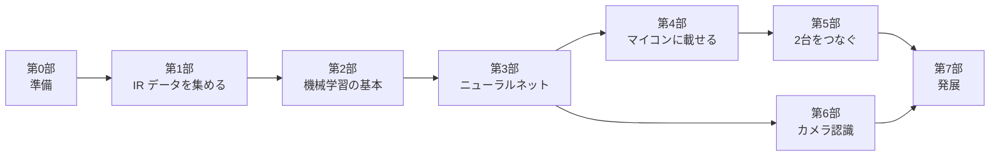

# RCJ Soccer 機械学習入門

ロボカップジュニア サッカー（赤外線）のロボットに、**機械学習**を組み込めるようになるための教材です。
IR センサとカメラの2つの「目」でボール・ゴール・相手ロボットを見つけるモデルを作り、マイコンの上で動かすところまで進みます。

理論 3 : 実装 7　理論は図とブラウザデモで直感をつかむ程度にして、手を動かす時間を多くとっています。

## この教材でできるようになること

- IR センサリングの値を集めて、**ボールの角度・距離・保持しているか**を推定するモデルを作る
- 作ったモデルを **Arduino / ESP32 / M5Stack CoreS3** の上で動かす
- CoreS3 のカメラで **ボール・ゴール・相手ロボット** を見つける
- IR とカメラの結果を合わせて、ロボットの動きに使う

## 全体の地図

## 読み方

- 本文は **中学生・高校生** が読めるように書いています。数学は高校の範囲まで、微分は図で説明します
- 各ページの最後にある **「もっと深く」** は、大学生レベルの補足です。飛ばしても先に進めます
- 手を動かすところは **Colab（ブラウザだけ）** と **ローカル（自分の PC）** の両方の手順があります。タブで切り替えてください

## 実機がなくても進められます

IR センサリングの**シミュレータ**と、公開用の**サンプル画像**を用意しています。
ロボットやセンサがなくても、学習してモデルを作るところまでは全部できます。実機がある人は、途中から自分のデータに差し替えます。

## 自分のチームのデータは公開しない

!!! private "この教材のルール"
    自分の機体のセンサの型番や個数、実機で取ったデータ、撮った画像、学習済みモデルは、大会で戦うための大事な情報です。
    この教材では、**教材（このサイト）は公開**、**チームの情報は非公開リポジトリ** に分けて進めます。やり方は [0-3](part0-setup/github.md) と [0-4](part0-setup/config.md) で説明します。

## 使うもの

| 種類 | 必須 | あると実機で試せる |
|---|---|---|
| PC | Windows または Mac | |
| アカウント | Google（Colab 用）、GitHub | |
| マイコン | | Arduino（Uno など）または ESP32、M5Stack CoreS3 |
| センサ | | IR センサ（ボール検出用）を複数個 |
| ボール | | RCJ の IR ボール |

まずは [第0部 準備](part0-setup/index.md) から始めましょう。
