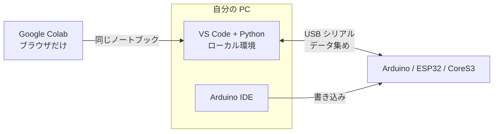

# 0-2 環境構築

## ねらい

- **Colab** で教材のノートブックを動かせるようにする
- 自分の PC に **Python** と **VS Code** を入れて、同じノートブックを動かせるようにする
- **Arduino IDE** で Arduino / ESP32 / M5Stack CoreS3 にプログラムを書き込めるようにする

## 3つの環境の関係



- **Colab**：インストール不要。学習（特に画像）は Colab の GPU が速い
- **ローカル**：実機とシリアル通信してデータを集めるときに必要
- **Arduino IDE**：マイコンにプログラムを書き込む

どちらの環境でも、**同じノートブック（`notebooks/` の `.ipynb`）** を使います。

---

## 手を動かす 1：Colab

1. Google アカウントでログインしておきます
2. 下のボタンを押すと、環境チェック用のノートブックが Colab で開きます

    [](https://colab.research.google.com/github/Asg1223/rcj-soccer-ml/blob/main/notebooks/00_check_environment.ipynb)

3. 上のセルから順に `Shift + Enter` で実行します
4. 最後に、ボールの方向のセンサほど値が大きい円グラフが出れば完了です

!!! tip "Colab のノートブックは保存されない"
    開いたノートブックを書きかえても、そのままでは保存されません。残したいときは「ファイル → ドライブにコピーを保存」を使います。

---

## 手を動かす 2：ローカル

### 1. Python を入れる

**Python 3.12** を入れます。第3部で使う TensorFlow が対応している版（3.10〜3.13）の中で、ほかのライブラリも安定して動く版です。

!!! warning "最新版（3.14 以降）は入れない"
    いちばん新しい Python だと、TensorFlow がまだ入らないことがあります。3.12 を選んでください。

=== "Windows"

    1. [python.org](https://www.python.org/downloads/) から Python 3.12 のインストーラを取ってきます
    2. インストーラの最初の画面で **「Add python.exe to PATH」にチェック** を入れてから Install
    3. PowerShell を開いて確認します

        ```powershell
        py -3.12 --version
        ```

=== "Mac"

    1. [python.org](https://www.python.org/downloads/) から Python 3.12 の macOS 用インストーラを取ってきて、インストールします
    2. ターミナルを開いて確認します

        ```bash
        python3.12 --version
        ```

### 2. Git と VS Code を入れる

- **Git**：[git-scm.com](https://git-scm.com/) から入れます（Mac はターミナルで `git --version` と打つと、入っていなければインストールが始まります）
- **VS Code**：[code.visualstudio.com](https://code.visualstudio.com/) から入れ、拡張機能の **Python** と **Jupyter** を入れます

### 3. 教材を手元に持ってきて、仮想環境を作る

「仮想環境」は、この教材専用の Python の部屋です。ほかの作業で入れたライブラリとぶつからなくなります。

=== "Windows"

    ```powershell
    cd ~
    git clone https://github.com/Asg1223/rcj-soccer-ml.git
    cd rcj-soccer-ml
    py -3.12 -m venv .venv
    .venv\Scripts\Activate.ps1
    python -m pip install --upgrade pip
    pip install -r requirements.txt
    pip install -e .
    python --version
    ```

=== "Mac"

    ```bash
    cd ~
    git clone https://github.com/Asg1223/rcj-soccer-ml.git
    cd rcj-soccer-ml
    python3.12 -m venv .venv
    source .venv/bin/activate
    python -m pip install --upgrade pip
    pip install -r requirements.txt
    pip install -e .
    python --version
    ```

行の先頭に `(.venv)` と出ていて、最後の `python --version` が **3.12.x** なら成功です。
`pip install -e .` は、教材用パッケージ `rcjml` を「このフォルダのコードをそのまま使う」形で入れるコマンドです。

!!! warning "VS Code の「環境の作成」を使うときは Python の版を選ぶ"
    VS Code のボタンから仮想環境を作ると、PC に入っているいちばん新しい Python（3.14 など）が自動で選ばれることがあります。
    作るときに **3.12** を選び直すか、上のコマンドで作ってから VS Code で `.venv` を選んでください。

!!! tip "uv を使う場合"
    [uv](https://docs.astral.sh/uv/) が入っていれば、Python 3.12 を別に入れなくても、次の方法で 3.12 の仮想環境を作れます（Windows / Mac 共通。Mac は2行目を `source .venv/bin/activate` にする）。

    ```powershell
    uv venv --python 3.12 .venv
    .venv\Scripts\Activate.ps1
    uv pip install -r requirements.txt
    uv pip install -e .
    python --version
    ```

### 4. ノートブックを動かす

1. VS Code で `rcj-soccer-ml` フォルダを開きます
2. `notebooks/00_check_environment.ipynb` を開きます
3. 右上の「カーネルの選択」で `.venv` の Python を選びます
4. 上のセルから順に実行し、円グラフが出れば完了です

---

## 手を動かす 3：Arduino IDE（実機）

### 1. Arduino IDE を入れる

[arduino.cc](https://www.arduino.cc/en/software) から **Arduino IDE 2** を入れます。

### 2. ボードの情報を追加する

「ファイル → 基本設定（Mac は Arduino IDE → Settings）」の **「追加のボードマネージャの URL」** に、次の2行を入れます。

```text
https://espressif.github.io/arduino-esp32/package_esp32_index.json
https://static-cdn.m5stack.com/resource/arduino/package_m5stack_index.json
```

左の **ボードマネージャ** で次の2つを検索してインストールします。

| 検索する言葉 | 入れるもの | 使うボード |
|---|---|---|
| `esp32` | esp32 by Espressif Systems | ESP32 |
| `M5Stack` | M5Stack | M5Stack CoreS3 |

Arduino Uno などは、最初から入っている「Arduino AVR Boards」で使えます。

### 3. ライブラリを入れる

左の **ライブラリマネージャ** で `M5Unified` を検索してインストールします。依存ライブラリ（M5GFX など）も入れるか聞かれたら「全部」を選びます。

### 4. 動作確認

=== "Arduino / ESP32"

    1. `firmware/check/serial_hello/serial_hello.ino` を開きます
    2. 「ツール → ボード」で自分のボードを、「ツール → ポート」で USB のポートを選びます
    3. 書き込み（→ ボタン）をします
    4. シリアルモニタを開き、速度を **115200** にして、`hello RCJ Soccer ML count=…` が1秒ごとに出れば完了です

=== "M5Stack CoreS3"

    1. `firmware/check/cores3_hello/cores3_hello.ino` を開きます
    2. 「ツール → ボード」で **M5CoreS3** を、「ツール → ポート」で USB のポートを選びます
    3. 書き込みをします
    4. 画面に `RCJ Soccer ML` と出て、画面をタッチすると数字が増えれば完了です

---

## チェック問題

1. 画像の学習をするときに、Colab を使うとよいのはなぜでしょう。
2. 仮想環境に入っているかどうかは、どこを見ればわかりますか。
3. CoreS3 に書き込もうとしたらポートが出てきません。まず何を確かめますか。

??? note "答え"
    1. Colab では GPU を無料で使えるので、画像の学習が速いからです。
    2. コマンドを打つ行の先頭に `(.venv)` と出ているかどうかです。
    3. USB ケーブルが「充電専用」ではなく「データ通信できる」ものかどうかです（下のつまずきポイントも参照）。

## つまずきポイント

??? failure "`py` や `python3.12` が見つからない"
    - Windows：Python のインストーラで「Add python.exe to PATH」にチェックを入れ忘れたかもしれません。インストーラをもう一度起動して「Modify」から直すか、入れ直します
    - Mac：ターミナルを一度閉じて開き直してから、もう一度試します

??? failure "`does not appear to be a Python project` と出る"
    `pip install -e .` や `pip install -r requirements.txt` を、**リポジトリのフォルダ以外** で実行しています（`.` は「今いるフォルダ」の意味です）。
    `cd rcj-soccer-ml` でフォルダに入ってから、もう一度実行します。

??? failure "仮想環境の Python が 3.12 ではなかった"
    作り直すのがいちばん早いです。リポジトリのフォルダで `.venv` フォルダを消してから、上の手順で 3.12 を指定して作り直します。

    ```powershell
    Remove-Item -Recurse -Force .venv   # Mac は rm -rf .venv
    ```

    Windows で `py -3.12` が「見つからない」と言われるときは、python.org の 3.12 を入れるか、上の「uv を使う場合」の手順を使います。

??? failure "`import serial` しても `serial.Serial` がないと言われる"
    `pyserial`（シリアル通信のライブラリ）とは別の、`serial` という名前のパッケージが入っていると、こうなります。

    ```bash
    pip uninstall serial
    pip install --force-reinstall pyserial
    ```

??? failure "Windows で `Activate.ps1` が「スクリプトの実行が無効」と言われる"
    PowerShell で次のコマンドを1回だけ実行してから、もう一度 `Activate.ps1` を実行します。

    ```powershell
    Set-ExecutionPolicy -Scope CurrentUser RemoteSigned
    ```

??? failure "ポートが出てこない"
    - USB ケーブルが充電専用だと通信できません。データ通信できるケーブルに替えます
    - 互換ボード（安い Arduino や ESP32）は、USB 変換チップのドライバが必要なことがあります。ボードの説明書を確認します

??? failure "CoreS3 に書き込めない"
    **リセットボタンを約2秒長押し** して、中の緑の LED が光ったら離します。書き込み待ちの状態になるので、もう一度書き込みます。

??? failure "Colab で `git clone` のセルが失敗する"
    いったん「ランタイム → セッションを再起動」してから、上のセルからやり直します。

## もっと深く

!!! deeper "uv と PlatformIO"
    - **uv** は Python の版と仮想環境とライブラリをまとめて管理できる、速いツールです。`uv venv --python 3.12` のように、Python の版を指定して環境を作れます。慣れてきたら pip＋venv の代わりに使ってみましょう
    - **PlatformIO** は VS Code の中でマイコン開発ができる拡張機能です。ボードやライブラリの版を `platformio.ini` に書いて固定できるので、チームで同じ環境をそろえやすくなります。この教材では入門しやすい Arduino IDE を使いますが、スケッチはどちらでも動くように書いています
