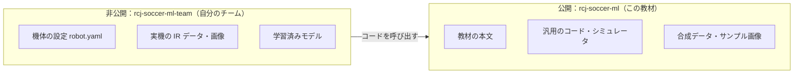

# 0-3 GitHub とチーム用リポジトリ

## ねらい

- 「公開してよいもの」と「公開しないもの」を分けて置く理由がわかる
- 自分のチーム用の **非公開（Private）リポジトリ** を作れる
- Colab で非公開のデータを安全に使える

## 理論：なぜ2つに分けるのか

大会では、センサの選び方や並べ方、集めたデータ、調整したモデルが**チームの強さそのもの**です。
一方で、機械学習のやり方（コード）は、みんなで共有したほうが全体のレベルが上がります。

そこで、置き場所を2つに分けます。



- 公開リポジトリには、**どの機体でも使える汎用のもの**だけを置く
- 非公開リポジトリには、**自分のチームだけのもの**を置く
- 非公開側から公開側のコードを呼び出して使う。公開側にはチームの情報を一切書かない

!!! private "非公開リポジトリに置くもの"
    - センサの型番と個数、並べた角度
    - どのボールに合わせて調整しているか、センサ側のマイコン
    - 実機で取った IR データ、撮った画像（知り合いのチームのロボットが写ったものを含む）
    - 学習済みモデル、調整したパラメータ

---

## 手を動かす 1：GitHub アカウントを作る

[github.com](https://github.com/) でアカウントを作ります。学校のメールアドレスでも個人のものでも構いません。

!!! tip "コマンドが苦手なら GitHub Desktop"
    [GitHub Desktop](https://desktop.github.com/) を使うと、ボタン操作で clone・コミット・push ができます。この教材ではコマンドで説明しますが、どちらでも同じことができます。

## 手を動かす 2：チーム用リポジトリを作る

1. GitHub の右上の「＋ → New repository」を押します
2. 次のように入力して「Create repository」を押します

    | 項目 | 入れるもの |
    |---|---|
    | Repository name | `rcj-soccer-ml-team`（好きな名前でよい） |
    | 公開範囲 | **Private** |
    | Add a README | チェックしない |

    !!! warning "必ず Private を選ぶ"
        Public を選ぶと、世界中の誰でも見られます。あとから変えられますが、一度公開したデータは誰かに保存されているかもしれません。最初から Private にします。

3. 教材リポジトリに入っている「チーム用リポジトリのひな形」をコピーして、最初のコミットをします

=== "Windows"

    ```powershell
    cd ~
    Copy-Item -Recurse rcj-soccer-ml\templates\team rcj-soccer-ml-team
    cd rcj-soccer-ml-team
    git init -b main
    git add .
    git commit -m "チーム用リポジトリを作成"
    git remote add origin https://github.com/あなたのユーザー名/rcj-soccer-ml-team.git
    git push -u origin main
    ```

=== "Mac"

    ```bash
    cd ~
    cp -R rcj-soccer-ml/templates/team rcj-soccer-ml-team
    cd rcj-soccer-ml-team
    git init -b main
    git add .
    git commit -m "チーム用リポジトリを作成"
    git remote add origin https://github.com/あなたのユーザー名/rcj-soccer-ml-team.git
    git push -u origin main
    ```

できあがるフォルダはこうなります。

```text
rcj-soccer-ml-team/
├─ configs/robot.yaml   # 自分の機体の設定（0-4 で書く）
├─ data/ir/             # 実機の IR データ
├─ data/camera/         # 画像とラベル
├─ models/              # 学習済みモデル
└─ notebooks/           # チーム用の実験ノート
```

チームの仲間は、GitHub のリポジトリの「Settings → Collaborators」から招待します。

## 手を動かす 3：Colab で非公開のデータを使う

Colab から非公開リポジトリを直接読むのは手間がかかるので、**Google ドライブ経由**で使います。

1. チーム用リポジトリのフォルダごと、Google ドライブ（例：マイドライブの直下）に置きます。パソコン版の Google ドライブを入れておくと、自動で同期されて楽です
2. ノートブックの最初で、ドライブをつないで設定ファイルの場所を教えます

```python
from google.colab import drive
drive.mount("/content/drive")

import os
os.environ["RCJML_CONFIG"] = "/content/drive/MyDrive/rcj-soccer-ml-team/configs/robot.yaml"
```

!!! private "ノートブックを公開側に保存しない"
    自分のデータを読み込んで実行したノートブックには、グラフや表としてデータが残ります。
    そのノートブックは、チーム用リポジトリかドライブに保存してください。

---

## 手を動かす 4：うっかり公開を防ぐ仕組み（公開リポジトリにコミットする人向け）

教材を手伝う人や、教材を自分用に fork して書きかえる人は、コミットの前に自動チェックが走るようにしておきます。

```bash
cd rcj-soccer-ml
pre-commit install
```

これで、コミットのたびに次のことが自動で確かめられます。

- ノートブックの出力（グラフ・表）を消す
- 実データ・チームの設定・学習済みモデルが混ざっていたら止める
- 決められた場所以外の画像や CSV、1 MB をこえるファイルがあったら止める
- `.private-words` に書いた言葉が入っていたら止める

`.private-words` は、リポジトリのいちばん上に自分で作るファイルです。1行に1語、**絶対に公開したくない言葉**（自分のセンサの型番など）を書きます。このファイル自体は公開されません（`.gitignore` で除外済み）。

```text
# .private-words の例（実際には自分のチームの言葉を書く）
MY-SECRET-SENSOR-123
```

GitHub に push したあとも、サイトを公開する直前に同じチェックがもう一度走ります。

## チェック問題

1. 知り合いのチームのロボットを撮った画像は、どちらのリポジトリに置きますか。
2. Colab で自分のデータを使うとき、データはどこに置きますか。
3. `.private-words` は公開リポジトリにコミットされますか。

??? note "答え"
    1. 非公開のチーム用リポジトリです。撮影と利用の許可をもらったうえで、チームの外に出さないようにします。
    2. Google ドライブに置き、`drive.mount` でつなぎます。
    3. されません。`.gitignore` で除外されています。

## つまずきポイント

??? failure "`git push` でユーザー名とパスワードを聞かれて失敗する"
    GitHub はパスワードでの push を受け付けません。GitHub Desktop を使うか、[GitHub CLI](https://cli.github.com/) を入れて `gh auth login` でログインすると楽です。

??? failure "pre-commit に止められた"
    表示されたファイルと理由を読みます。本当に公開してよいものなら置き場所を直し、チームの情報なら公開リポジトリから外してチーム用リポジトリに移します。

## もっと深く

!!! deeper "Git の履歴からは簡単に消えない"
    一度コミットして push したファイルは、あとで削除しても **履歴に残ります**。履歴から消すには `git filter-repo` などで履歴を書きかえる必要があり、すでに誰かが clone していれば手遅れです。
    だからこの教材では、「コミットの前に止める（pre-commit）」「公開の前にもう一度止める（GitHub Actions）」の2段構えにしています。セキュリティでいう **多層防御** の考え方です。
