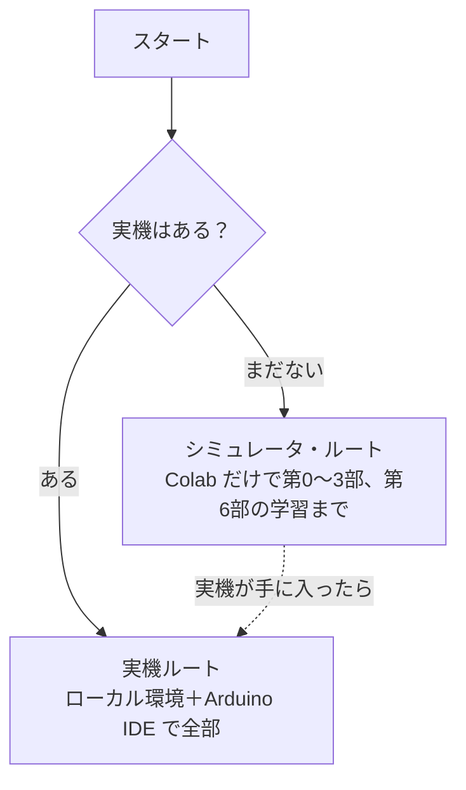

# 0-1 この教材の使い方

## ねらい

- 各ページがどんな順番で書かれているかを知る
- 自分に合った進め方（ルート）を選ぶ

## ページの型

ほとんどのページは、次の順番で書かれています。

1. **ねらい** … このページで何ができるようになるか
2. **理論** … 図やブラウザデモで、仕組みをざっくりつかむ
3. **手を動かす** … コードを書いて動かす（ページのいちばん長い部分）
4. **チェック問題** … わかったかどうかを確かめる 2〜3 問
5. **つまずきポイント** … よくあるエラーと直し方
6. **もっと深く** … 大学生レベルの補足（飛ばしてよい）

## 記号の意味

!!! tip "ヒント"
    知っておくと楽になること。

!!! warning "注意"
    やり方を間違えると、壊れたり時間がかかったりすること。

!!! private "公開しない"
    自分のチームの情報を守るための注意。ここに書かれたものは公開リポジトリに入れない。

!!! deeper "もっと深く"
    大学生レベルの補足。数式や理屈をくわしく説明する。

## タブの使い方

手を動かすところは、環境ごとにタブで分かれています。自分の環境のタブを選んでください。一度選ぶと、ほかのページでも同じタブが選ばれます。

=== "Colab"

    ブラウザだけで動かすときの手順がここに書かれます。

=== "ローカル"

    自分の PC に入れた Python で動かすときの手順がここに書かれます。

=== "実機"

    Arduino / ESP32 / CoreS3 を使うときの手順がここに書かれます。

## 進め方のルート

- **シミュレータ・ルート**：PC と Google アカウントだけで始められます。IR センサのデータはシミュレータで作り、画像は公開用のサンプルを使います
- **実機ルート**：自分のロボットでデータを取り、マイコンでモデルを動かします。最初からこちらを選んでも大丈夫です

## チェック問題

1. 「もっと深く」を飛ばしても、次のページに進めるでしょうか。
2. 自分のチームのセンサの型番は、どこに書くべきでしょうか（ヒント：0-4）。

??? note "答え"
    1. 進めます。本文だけで先に進めるように書いています。
    2. チーム用（非公開）リポジトリの設定ファイル `configs/robot.yaml` に書きます。このサイトや公開リポジトリには書きません。
