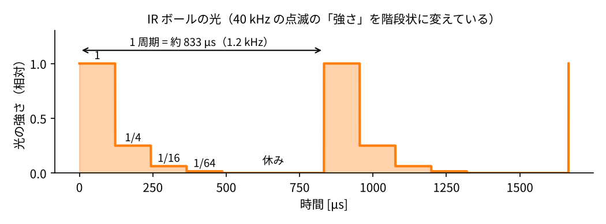
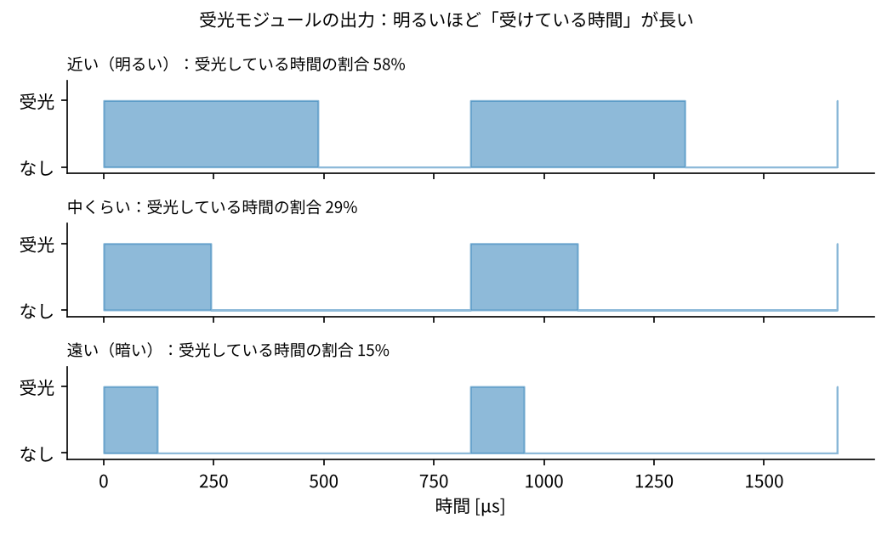

# 1-1 IR ボールとセンサの仕組み

## ねらい

- IR ボールがどんな光を出していて、センサがそれをどう「数字」にしているかを説明できる
- 実機のデータが「きれいにならない」理由を、シミュレータで1つずつ確かめる

---

## 理論 1：ボールはどんな光を出しているか

RCJ の IR ボール（大型ボールも、2026年からのゴルフボールサイズのボールも）は、目に見えない **赤外線**（波長 920〜960 nm）を出しています。ただ光っているのではなく、決まったリズムで点滅しています。

1. **40 kHz の点滅**（1秒に4万回）：太陽や照明の赤外線と区別するための「合図」です
2. **点滅の強さを階段状に変える**：1周期（約 833 µs、1秒に 1,200 回）の中で、強さを **1 → 1/4 → 1/16 → 1/64** と下げ、そのあと少し休みます



*模式図。段の長さは見やすくするため同じにしています。正確な形は [ボールの仕様](https://robocup-junior.github.io/soccer-rules/master/ball_specification.html) を参照。*

## 理論 2：センサはどうやって「明るさ」を測るか

よく使われるのは、テレビのリモコン用と同じ **赤外線受光モジュール** です。40 kHz で点滅する光を受けている間だけ、出力が変わります（多くは LOW になる）。

ここで階段状の強さが効いてきます。受光モジュールには「これより暗いと反応しない」という **しきい値** があります。

- ボールが **近い**（明るい）：1/64 の段まで反応できるので、**長い時間** 受光する
- ボールが **遠い**（暗い）：いちばん強い段しか届かないので、**短い時間** しか受光しない



つまり、**「受光している時間の割合」を測れば、どれくらい明るいか（＝どれくらい近いか）がわかります**。1-2 のスケッチは、これを数字にしています。

!!! tip "向きはどうやって知るのか"
    センサを輪のように並べて（センサリング）、どのセンサがいちばん強く反応しているかを見ます。ボールの方向を向いたセンサほど、値が大きくなります。

## 理論 3：実機のデータがきれいにならない理由

教科書どおりなら「ボールの方向のセンサがいちばん大きい」だけで済みます。でも実機では、こんなことが起きます。

| くせ | 何が起きるか | シミュレータでの名前 |
|---|---|---|
| センサの個体差 | 同じ明るさでも、センサごとに値が少し違う | `gain_spread` |
| 取り付けのずれ | センサが設計より少し違う方向を向いている | `offset_spread_deg` |
| 機体の影 | 柱やキャッチャーが光をさえぎる | `body_shadow` |
| 外乱光 | 照明や窓からの赤外線で、関係ないセンサが反応する | `ambient_mean`, `ambient_dir` |
| ボールの明るさの変化 | ボールの電池が減ると暗くなる | `ball_spread` |
| 反射 | 壁や物に当たった光が、別の方向から届く | `reflection_prob` |
| 遮へい | 相手ロボットが間に入って光がさえぎられる | `occlusion_prob` |
| ボール以外の赤外線 | 相手ロボットのセンサなどが光っている | `stray_prob` |
| 読み取りのくせ | しきい値で 0 になる、近すぎると最大値に張りつく、値が段階的 | `threshold`, `levels` |

教材のシミュレータは、これらを全部まねしています。難しさ（`difficulty`）は3段階です。

| 難しさ | 中身 |
|---|---|
| `easy` | くせがほとんどない |
| `normal` | 上のくせが一通り入る（何も指定しないとこれ） |
| `hard` | 大会会場を想定。反射・遮へい・外乱光が強い |

---

## 手を動かす：くせを1つずつ足してみる

同じ場所（左斜め前 45°、40 cm）にボールを置いたまま、くせを1つずつ足して、センサの値がどう変わるかを見ます。

=== "Colab"

    下のボタンでノートブックを開き、上から順に実行します。このページのコードがそのまま入っています。

    [](https://colab.research.google.com/github/Asg1223/rcj-soccer-ml/blob/main/notebooks/01_ir_data.ipynb)

=== "ローカル"

    VS Code で `notebooks/01_ir_data.ipynb` を開きます。このページのコードがそのまま入っています。

まず、くせのない `easy` で描きます。

```python
import numpy as np
import matplotlib.pyplot as plt
from dataclasses import replace
from rcjml import load_config
from rcjml.sim import simulate, DIFFICULTIES
from rcjml.plot import polar

cfg = load_config()
easy = DIFFICULTIES["easy"]

values = simulate(cfg, 45, 40, difficulty=easy, rng=np.random.default_rng(0))[0]
ax = plt.subplot(projection="polar")
polar(ax, cfg, values, true_angle=45, title="easy")
plt.show()
```

オレンジの線が本当のボールの方向です。その近くのセンサほど値が大きくなっています。

次に、くせを1つずつ足した版を並べます。`replace(easy, ...)` は「easy の設定のうち、ここだけ変える」という意味です。

```python
from rcjml.plot import polar_grid

variants = {
    "easy": easy,
    "gain / offset": replace(easy, gain_spread=0.3, offset_spread_deg=8.0),
    "body shadow": replace(easy, body_shadow=0.7),
    "ambient light": replace(easy, ambient_mean=1.0, ambient_dir=4.0),
    "reflection": replace(easy, reflection_prob=1.0, reflection_coef=(0.5, 0.7)),
    "occlusion": replace(easy, occlusion_prob=1.0, occlusion_keep=(0.1, 0.1)),
    "stray IR": replace(easy, stray_prob=1.0, stray_level=(30.0, 60.0)),
    "threshold / levels": replace(easy, threshold=1.5, levels=32, jitter=0.18),
}

rows = [simulate(cfg, 45, 40, difficulty=d, rng=np.random.default_rng(1))[0] for d in variants.values()]
polar_grid(cfg, rows, titles=list(variants), true_angles=[45] * len(rows))
plt.show()
```

最後に、全部入りの `normal` と `hard` で、同じ場所を5回ずつ測ってみます。**同じ場所なのに毎回ちがう** ことに注目してください。

```python
from rcjml.sim import sample_session

rng = np.random.default_rng(2)
rows, titles = [], []
for diff in ["normal", "hard"]:
    session = sample_session(diff, rng)
    for k in range(4):
        rows.append(simulate(cfg, 45, 40, difficulty=diff, session=session, rng=rng)[0])
        titles.append(f"{diff} #{k + 1}")
polar_grid(cfg, rows, titles=titles, true_angles=[45] * len(rows))
plt.show()
```

!!! example "やってみよう"
    1. ボールの角度と距離を変えて（例：真後ろ 180°、10 cm）同じことをしてみましょう。どのくせがいちばん「ボールの方向」をわかりにくくしますか。
    2. `cfg.ball_type = "golf_ir"` にしてから、もう一度描いてみましょう。大型ボールと何がちがいますか。

---

## チェック問題

1. ボールが 40 kHz で点滅しているのは何のためでしょう。
2. ボールが遠くなると、受光モジュールが「受光している時間」はどうなりますか。それはなぜですか。
3. 反射が起きると、センサの値はどう見えるでしょう。

??? note "答え"
    1. 太陽や照明の赤外線と区別するためです。受光モジュールは 40 kHz で点滅する光にだけ反応します。
    2. 短くなります。遠いと暗くなり、強さの低い段（1/16、1/64）がしきい値に届かなくなるからです。
    3. ボールの方向とは別の方向にも、もう1つの「山」ができます。どちらが本物か、見分けにくくなります。

## つまずきポイント

??? failure "`replace` で `unexpected keyword argument` と出る"
    くせの名前のつづりが違います。使える名前は `DIFFICULTIES["easy"]` を `print` すると全部表示されます。

??? failure "グラフが出ない（ローカル）"
    VS Code のノートブックでは、セルの最後の `plt.show()` で表示されます。ターミナルから `.py` として実行した場合は、ウィンドウが開くまで少し待ちます。

## もっと深く

!!! deeper "受光時間は明るさの「対数」に近い"
    強さの段は 1、1/4、1/16、1/64 と、毎回 1/4 になっています。しきい値を $T$、ボールの明るさを $I$ とすると、反応できる段の数はおよそ

    $$
    k \approx \log_4 \frac{I}{T}
    $$

    です。受光時間は $k$ にほぼ比例するので、**受光時間は明るさの対数** に近くなります。
    明るさは距離の2乗に反比例して弱くなる（$I \propto 1/d^2$）ので、受光時間は $\log d$ の一次式に近い形になります。シミュレータの「対数っぽい応答」は、この性質をまねしたものです。
    ただし実際には、ボールの LED のむら、受光モジュールの反応の遅れ、段の長さの違いなどで、きれいな直線にはなりません。だからこそ、データから関係を学ぶ機械学習の出番があります。
