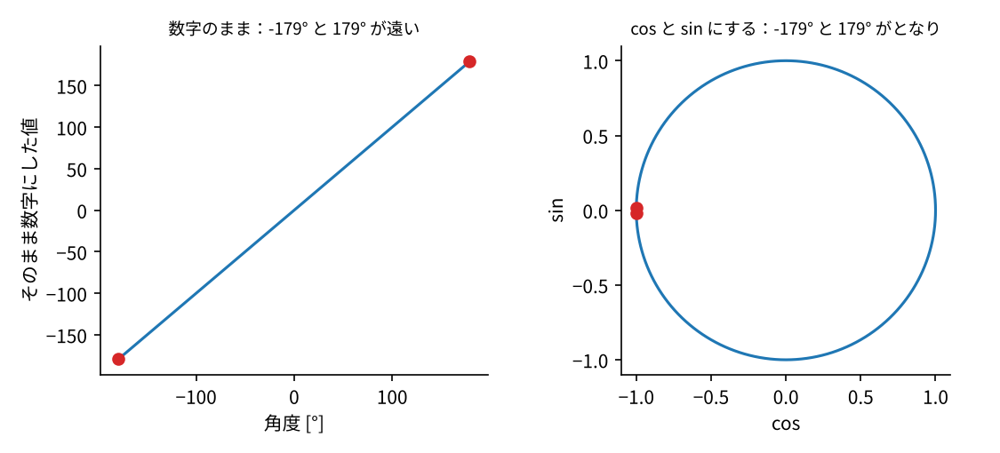

# 2-3 角度は輪っか：359° と 1° の問題

## ねらい

- 角度をそのまま数字として予測すると、なぜうまくいかないかを説明できる
- 角度を **cos と sin の2つ** にして予測し、`atan2` で角度に戻せる
- 角度の誤差を正しく計算する関数を自分で書ける

---

## 理論 1：角度は「端と端がつながっている」

ボールが真後ろ近くにあるとき、角度は **179°** だったり **-179°** だったりします。数字としては 358 も離れていますが、実際には **2° しか違いません**。

数字の線は端と端がつながっていませんが、角度は **輪っか** です。そのまま数字として扱うと、モデルは「179° と -179° はまったく別の場所」だと思って学習してしまいます。



## 理論 2：cos と sin にすれば輪っかになる

角度 $\theta$ を、半径 1 の円の上の点 $(\cos\theta, \sin\theta)$ で表すと、179° と -179° は **となりあった点** になります。だから 2-2 では、角度そのものではなく、cos と sin の2つを予測しました。

予測した $(\hat{c}, \hat{s})$ から角度に戻すには **atan2** を使います。

$$
\hat{\theta} = \operatorname{atan2}(\hat{s},\ \hat{c})
$$

`atan2` は、点の位置を見て -180°〜180° のどこかを返してくれます。予測した点がぴったり円の上になくても大丈夫です。

## 理論 3：誤差も輪っかで測る

誤差も同じで、179° と -179° の差を 358° と数えてはいけません。差を **-180°〜180° に折りたたむ** と正しくなります。

$$
\text{差} = ((\hat{\theta} - \theta + 180) \bmod 360) - 180
$$

`mod` は割った余りです。この絶対値が角度の誤差です。

---

## 手を動かす 1：角度をそのまま予測してみる（わざと失敗する）

2-2 と同じ線形モデルで、正解を **角度そのもの** にしてみます。今回は、重みを一発で求める最小二乗法（`np.linalg.lstsq`、2-2 の「もっと深く」）を使います。

```python
import numpy as np
import matplotlib.pyplot as plt
from rcjml import load_config
from rcjml.data import load_synthetic, sensor_columns, split_by_session

cfg = load_config()
df = load_synthetic("ring12_large_normal")
S = sensor_columns(df)
train, test = split_by_session(df)

def features(d):
    return np.c_[d[S].values / cfg.ir.max_reading, np.ones(len(d))]

w, *_ = np.linalg.lstsq(features(train), train["angle_deg"].values, rcond=None)
pred_raw = features(test) @ w
```

## 手を動かす 2：誤差の関数を自分で書く

```python
def angle_error(pred_deg, true_deg):
    diff = (np.asarray(pred_deg) - np.asarray(true_deg) + 180) % 360 - 180
    return np.abs(diff)

print(angle_error(179, -179))    # 2 になれば正解
print(angle_error(10, 350))      # 20 になれば正解
```

教材の `rcjml.sim.angle_error_deg` も、中身はこれと同じです。

## 手を動かす 3：比べる

角度をそのまま予測した場合と、cos・sin を予測した場合を比べます。

```python
th = np.deg2rad(train["angle_deg"].values)
W, *_ = np.linalg.lstsq(features(train), np.c_[np.cos(th), np.sin(th)], rcond=None)
P = features(test) @ W
pred_ring = np.rad2deg(np.arctan2(P[:, 1], P[:, 0]))

err_raw = angle_error(pred_raw, test["angle_deg"])
err_ring = angle_error(pred_ring, test["angle_deg"])
print(f"角度をそのまま : {err_raw.mean():.1f}°")
print(f"cos と sin     : {err_ring.mean():.1f}°")

fig, axes = plt.subplots(1, 2, figsize=(10, 4), sharey=True)
for ax, pred, name in [(axes[0], pred_raw, "raw angle"), (axes[1], pred_ring, "cos / sin")]:
    ax.scatter(test["angle_deg"], pred, s=3, alpha=0.4)
    ax.plot([-180, 180], [-180, 180], color="tab:orange")
    ax.set_xlabel("true angle [deg]")
    ax.set_title(name)
axes[0].set_ylabel("predicted angle [deg]")
plt.show()
```

| 正解の形 | 平均誤差（normal） |
|---|---|
| 角度をそのまま | 38.3° |
| cos と sin | 8.9° |

左のグラフ（そのまま）では、真後ろ（±180° 付近）のボールの予測が、真ん中の 0° 付近に寄っています。モデルが「179° と -179° の真ん中」を答えようとして、**真後ろのボールを正面と答えてしまう** のです。ロボットにとっては最悪のまちがいです。

!!! example "やってみよう"
    1. 角度をそのまま予測した場合、誤差の大きいデータはどの角度に多いでしょう。`test["angle_deg"][err_raw > 90]` を調べてみましょう。
    2. 予測した点 $(\hat{c}, \hat{s})$ の、円の中心からの距離 $\sqrt{\hat{c}^2 + \hat{s}^2}$ を計算してみましょう。距離が小さいとき（円の中心に近いとき）、角度の誤差は大きいでしょうか、小さいでしょうか。

---

## チェック問題

1. 角度 350° を、-180°〜180° の表し方に直すと何度ですか。
2. cos と sin を予測したら、(-0.5, 0.0) になりました。角度は何度ですか。
3. 予測した点が (0.02, 0.01) のように円の中心にとても近いとき、その角度は信用できますか。

??? note "答え"
    1. -10° です。
    2. 180°（真後ろ）です。`atan2(0.0, -0.5)` = 180°。
    3. あまり信用できません。中心に近い点は、少し動いただけで角度が大きく変わります。「自信がない」という合図として使えます（7-2 で使います）。

## つまずきポイント

??? failure "`atan2` の引数の順番をまちがえる"
    NumPy の `np.arctan2(y, x)` は **y（sin）が先** です。逆にすると、角度が 90° 回ったような答えになります。

??? failure "誤差が 180° を超える"
    角度の誤差を普通の引き算で計算しています。このページの `angle_error` を使います。

## もっと深く

!!! deeper "周期のあるものは全部この方法が使える"
    角度のように「一周すると元に戻る」量を **周期的な量** といいます。時刻（23 時と 0 時はとなり）、曜日、月なども同じで、機械学習ではよく cos と sin に分けて入力や出力にします。
    また、第3部でニューラルネットを使うときは、予測した点を円の上に乗せる（長さで割る）工夫や、角度の差を直接小さくする損失（$1 - \cos(\hat{\theta} - \theta)$ など）も使えます。
