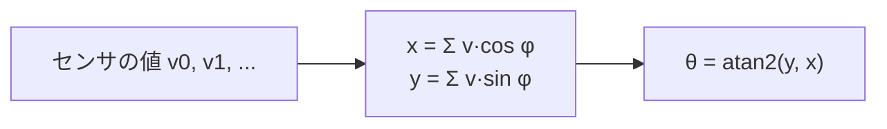

# 2-1 まずは従来の方法：重み付きベクトル和

## ねらい

- 多くのチームが使っている「重み付きベクトル和」で、ボールの角度を計算できる
- 誤差を数字で測り、**機械学習と比べるための基準（ベースライン）** を作る

!!! tip "なぜ従来の方法から始めるのか"
    機械学習のモデルを作っても、「それは本当に良くなったのか」を判断する基準がないと意味がありません。**簡単な方法でどこまでできるか** を先に測っておくのが、機械学習の基本の進め方です。

---

## 理論：センサを「矢印」にして足す

各センサを、そのセンサが向いている方向の **矢印** だと考えます。矢印の長さは、そのセンサの値です。

全部の矢印を足すと、強く反応しているセンサの方向に長い矢印ができます。その **合計の矢印の向き** を、ボールの方向とします。

センサ $i$ の向きを $\varphi_i$、値を $v_i$ とすると、合計の矢印の横（x）と縦（y）の成分は

$$
x = \sum_i v_i \cos \varphi_i, \qquad y = \sum_i v_i \sin \varphi_i
$$

で、ボールの角度は

$$
\theta = \operatorname{atan2}(y,\ x)
$$

です。`atan2(y, x)` は、点 $(x, y)$ の方向の角度を -180°〜180° で返す関数です（2-3 でくわしく扱います）。



---

## 手を動かす

=== "Colab / ローカル"

    `notebooks/02_angle_estimation.ipynb` に、第2部のコードが全部入っています。

    [](https://colab.research.google.com/github/Asg1223/rcj-soccer-ml/blob/main/notebooks/02_angle_estimation.ipynb)

### 1. データを用意する

第2部では、合成データの `normal` を主に使います。**学習用** と **テスト用** に分けておきます（分け方の理由は 2-4 で説明します）。

```python
import numpy as np
import pandas as pd
import matplotlib.pyplot as plt
from rcjml import load_config
from rcjml.data import load_synthetic, sensor_columns, split_by_session

cfg = load_config()
df = load_synthetic("ring12_large_normal")
S = sensor_columns(df)
train, test = split_by_session(df)       # 取り直しの後ろ 1/4 をテスト用にする
print(len(train), len(test))
```

### 2. 自分で書く

上の式を、そのまま NumPy で書きます。

```python
def vector_sum_angle(values, sensor_angles_deg):
    phi = np.deg2rad(sensor_angles_deg)         # 度 → ラジアン
    x = (values * np.cos(phi)).sum(axis=1)      # 行ごとに足す
    y = (values * np.sin(phi)).sum(axis=1)
    return np.rad2deg(np.arctan2(y, x))         # ラジアン → 度

pred = vector_sum_angle(test[S].values, cfg.ir.angles_deg)
pred[:5].round(1), test["angle_deg"].values[:5]
```

### 3. 誤差を測る

角度の誤差は、ただ引き算すると困ることがあります（179° と -179° の差は 358° ではなく 2°）。くわしくは 2-3 で扱うので、ここでは教材の関数 `angle_error_deg` を使います。

```python
from rcjml.sim import angle_error_deg

err = angle_error_deg(pred, test["angle_deg"])
print(f"平均誤差（MAE）: {err.mean():.1f}°")
print(f"真ん中の値     : {np.median(err):.1f}°")
print(f"90% の範囲     : {np.percentile(err, 90):.1f}° 以内")
```

`normal` のテスト用データでは、**平均 9.4°、真ん中の値 5.6°、90% が 21.7° 以内** になります。

- **平均（MAE）**：誤差の平均。この教材ではこれを主な成績にします
- **真ん中の値（中央値）**：小さい順に並べた真ん中。たまにある大はずれに引っぱられにくい
- **90% の範囲**：10 回に 1 回はこれ以上外れる、という目安

### 4. どこで外しているか

誤差を、ボールまでの距離ごとに見ます。

```python
fig, axes = plt.subplots(1, 2, figsize=(11, 3.8))
axes[0].hist(err, bins=60)
axes[0].set_xlabel("angle error [deg]")
axes[0].set_ylabel("count")
axes[0].set_yscale("log")

axes[1].scatter(test["distance_cm"], err, s=4, alpha=0.4)
axes[1].set_xlabel("distance [cm]")
axes[1].set_ylabel("angle error [deg]")
plt.tight_layout()
plt.show()
```

ほとんどは小さな誤差ですが、**遠いほど大はずれが増える** ことがわかります（1-5 で見たとおりです）。

### 5. 難しさを変えて比べる

```python
results = {}
for name in ["ring12_large_easy", "ring12_large_normal", "ring12_large_hard", "ring12_golf_normal"]:
    d = load_synthetic(name)
    _, t = split_by_session(d)
    e = angle_error_deg(vector_sum_angle(t[S].values, cfg.ir.angles_deg), t["angle_deg"])
    results[name] = {"MAE": e.mean(), "median": np.median(e), "p90": np.percentile(e, 90)}
pd.DataFrame(results).T.round(1)
```

| データ | 平均 | 真ん中 | 90% |
|---|---|---|---|
| easy | 0.8° | 0.7° | 1.6° |
| normal（大型ボール） | 9.4° | 5.6° | 21.7° |
| hard（大型ボール） | 19.8° | 10.1° | 48.9° |
| normal（ゴルフボールサイズ） | 17.9° | 7.7° | 46.0° |

くせのない `easy` ならほぼ完璧ですが、実機らしいくせが入ると誤差が大きくなります。**これが、この教材で機械学習が超えるべき基準です**。

!!! example "やってみよう"
    1. センサの値を **2乗してから** 足すと、誤差はどうなるでしょう（`values ** 2` にする）。強いセンサをより重視することになります。
    2. いちばん大きいセンサとその両どなりの3つだけで計算すると、どうなるでしょう。

---

## チェック問題

1. 重み付きベクトル和で、全部のセンサの値が同じとき（たとえば全部 0 で、ボールが見えないとき）、答えはどうなりますか。
2. MAE が同じ 10° の2つの方法があります。片方は「いつも 10° くらい外す」、もう片方は「ふだんは 1°、たまに 90° 外す」です。ロボットにとってはどちらが困りますか。

??? note "答え"
    1. 矢印が打ち消し合って合計が 0 になります。`atan2(0, 0)` は 0°（正面）を返すので、**ボールが見えないのに「正面にある」と答えてしまいます**。値が少しだけある場合も、ノイズで決まる意味のない角度になります。ボールが見えないときは、別に判定する必要があります（7-2 で扱います）。
    2. 場面によりますが、「たまに 90° 外す」ほうがボールと逆に走り出すなどの大きな失敗につながりやすいです。だから MAE だけでなく、真ん中の値や 90% の範囲も見ます。

## つまずきポイント

??? failure "誤差が 90° や 180° くらいになる"
    センサの角度の向き（反時計回りが ＋）と、配線の順番が逆になっているかもしれません。1-2 の動作チェックをやり直します。合成データなら、`cfg` が別のセンサ数の設定になっていないか確かめます。

## もっと深く

!!! deeper "重み付きベクトル和は「重みを手で決めた」モデル"
    式を書きかえると、

    $$
    x = \sum_i (\cos\varphi_i)\, v_i, \qquad y = \sum_i (\sin\varphi_i)\, v_i
    $$

    つまり、センサの値に **決まった重み**（$\cos\varphi_i$、$\sin\varphi_i$）をかけて足したものです。これは次の 2-2 で扱う **線形モデル** そのものです。
    違いは、重みを **設計図から手で決めた** か、**データから学んだ** かだけです。センサの取り付けがずれていたり、感度に個体差があったりすると、設計図どおりの重みは最適ではなくなります。そこで、重みをデータから決めてみよう、というのが次の章です。
