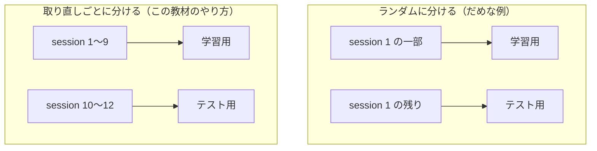

# 2-4 正しく評価する：学習用とテスト用の分け方

## ねらい

- 学習に使ったデータでテストしてはいけない理由がわかる
- **取り直し（session）ごとに分ける** 理由を、実験で確かめられる
- 本番に近い条件で、モデルの実力を測れる

---

## 理論 1：テストは「初めて見る問題」でやる

学校のテストで、授業でやった問題とまったく同じ問題が出たら、答えを覚えているだけでも満点がとれます。でもそれは実力ではありません。

モデルも同じです。学習に使ったデータでテストすると、**答えを覚えているだけ** でも良い点になります。だから、データを

- **学習用**（モデルが答えを見て学ぶ）
- **テスト用**（学習には使わず、最後に成績をつけるためだけに使う）

に分けます。

## 理論 2：「似すぎた問題」もテストに入れない

ここが、ロボットのデータで特に大事なところです。

同じ取り直し（同じ日・同じ場所・同じボール）のデータは、**とても似ています**。たとえば、1-4 では1か所につき 20 回測りました。この 20 行はほぼ同じ値です。

データを **ばらばらに（ランダムに）** 分けると、20 行のうち 15 行が学習用、5 行がテスト用、のように同じ場所のデータが両方に入ります。すると、テストの問題は「授業でやった問題とほぼ同じ」になってしまい、**本番より良い点が出ます**。

本番の大会は、**初めての会場・初めての照明・初めてのボール** です。それに近い評価にするには、**取り直しごとに分けて**、テスト用の取り直しは学習に一切使わないようにします。



---

## 手を動かす：分け方で成績がどれだけ変わるか

`hard` のデータで、2つの分け方を比べます。モデルには、**似ているデータの答えを借りてくる** タイプの **k 近傍法**（KNN）と、**ランダムフォレスト** を使います（どちらも 2-5 でくわしく扱います）。どちらも「覚えるのが得意」なモデルなので、分け方の違いが出やすいのです。

```python
import numpy as np
import pandas as pd
from sklearn.model_selection import train_test_split
from sklearn.neighbors import KNeighborsRegressor
from sklearn.ensemble import RandomForestRegressor
from rcjml import load_config
from rcjml.data import load_synthetic, sensor_columns, split_by_session
from rcjml.sim import angle_error_deg

cfg = load_config()
df = load_synthetic("ring12_large_hard")
S = sensor_columns(df)

def xy(d):
    th = np.deg2rad(d["angle_deg"].values)
    return d[S].values / cfg.ir.max_reading, np.c_[np.cos(th), np.sin(th)]

def score(model, train, test):
    X, Y = xy(train)
    model.fit(X, Y)
    P = model.predict(xy(test)[0])
    pred = np.rad2deg(np.arctan2(P[:, 1], P[:, 0]))
    return angle_error_deg(pred, test["angle_deg"]).mean()

splits = {
    "random": train_test_split(df, test_size=0.25, random_state=0),
    "by session": split_by_session(df),
}
models = {
    "KNN (k=5)": lambda: KNeighborsRegressor(n_neighbors=5),
    "random forest": lambda: RandomForestRegressor(n_estimators=200, n_jobs=-1, random_state=0),
}
rows = {m: {s: score(make(), *splits[s]) for s in splits} for m, make in models.items()}
pd.DataFrame(rows).T.round(1)
```

| モデル | ランダムに分けた | 取り直しごとに分けた |
|---|---|---|
| KNN（k=5） | 14.4° | 17.3° |
| ランダムフォレスト | 13.3° | 16.8° |

ランダムに分けると、**3° 前後よく見えます**。でも、それは「似た問題を覚えていた」分です。本番で期待できるのは、右の列の成績です。

!!! warning "この教材のルール"
    この教材では、**いつも `split_by_session` で取り直しごとに分けます**。自分で集めたデータでも、取り直しの番号を必ず記録してください（1-4）。

!!! example "やってみよう"
    1. `normal` のデータ（`ring12_large_normal`）で同じことをすると、差はどれくらいでしょう。`hard` より差が小さいのはなぜだと思いますか。
    2. テスト用を 1/4 ではなく 1/2 にする（`split_by_session(df, test_fraction=0.5)`）と、成績はどう変わるでしょう。

??? note "やってみよう 1 のヒント"
    `hard` は、取り直しごとの条件の違い（外乱光、ボールの明るさ）が大きく作ってあります。違いが大きいほど、「初めての条件」でのテストは難しくなり、分け方の差も大きくなります。

---

## チェック問題

1. 学習用のデータで成績をつけると、なぜ良すぎる点になるのでしょう。
2. 大会の会場で 10 分だけデータを取りました。これを学習にもテストにも使うには、どう分けるとよいでしょう。
3. 何度もテスト用データで成績を見ながらモデルを直していたら、テストの成績はどんどん良くなりました。何に気をつけるべきでしょう。

??? note "答え"
    1. モデルがその答えを覚えていれば、実力がなくても当てられるからです。
    2. たとえば、最初の 7 分を学習用、最後の 3 分をテスト用にするなど、**時間でまとまりごとに** 分けます。ランダムに分けると、ほぼ同じデータが両方に入ります。
    3. テスト用データに合わせてモデルを選んでいるので、テスト用データを「間接的に学習」しています。本当の実力より良く見えている可能性があります（もっと深く を参照）。

## つまずきポイント

??? failure "テスト用データが空になる"
    取り直しの数が少なすぎます。`split_by_session` は、取り直しの数 × `test_fraction` 個（少なくとも1つ）をテスト用にします。取り直しが1つしかないと、学習用が空になります。最低でも 3〜4 回は取り直しましょう。

## もっと深く

!!! deeper "検証用データと交差検証"
    モデルを選んだり、設定（k の数、学習率など）を調整したりするときに、テスト用データを使うと、テストの意味がなくなります。そこで、学習用データの中をさらに分けて **検証用データ** を作り、調整は検証用データで行い、テスト用データは **最後に1回だけ** 使います。
    データが少ないときは、学習用の取り直しを順番に1つずつ検証用にして平均をとる **交差検証** を使います。取り直しごとに分ける交差検証は、scikit-learn では `GroupKFold` や `LeaveOneGroupOut` で書けます。

    ```python
    from sklearn.model_selection import GroupKFold, cross_val_score
    cv = GroupKFold(n_splits=4)
    # cross_val_score(model, X, Y, groups=train["session"], cv=cv)
    ```

    このように、学習と評価のデータが「本番では起きない形でつながってしまう」ことを **データリーク** といいます。機械学習のコンテスト（Kaggle など）でも、いちばんよくある失敗の1つです。
