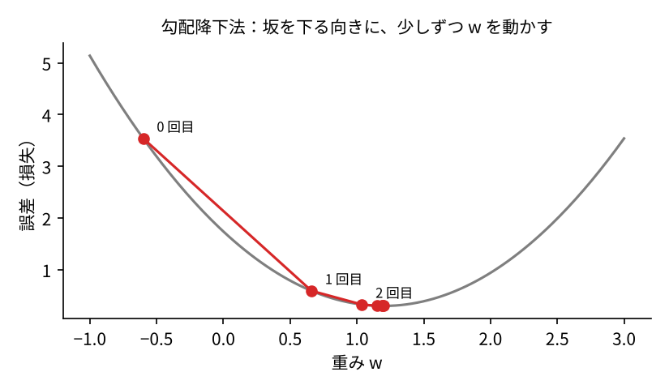

# 2-2 重みをデータから決める：線形回帰と勾配降下法

## ねらい

- 「予測」「誤差（損失）」「重みを少しずつ直す」という、機械学習の基本の流れがわかる
- 線形回帰を NumPy だけで一から書き、ボールの角度を推定できる
- 2-1 の重み付きベクトル和と、学んだ重みを比べられる

---

## 理論 1：線形モデル

**線形モデル** は、「入力に重みをかけて足し、最後に定数を足す」だけのモデルです。

$$
\hat{y} = w_0 x_0 + w_1 x_1 + \cdots + w_{11} x_{11} + b
$$

- $x_i$：センサ $i$ の値（入力）
- $w_i$：センサ $i$ の **重み**（どれくらい重視するか）
- $b$：**バイアス**（全体を少しずらす定数）
- $\hat{y}$：モデルの **予測**（ハットは「予測した値」の印）

2-1 の重み付きベクトル和も、重みを $\cos\varphi_i$ に決めた線形モデルでした。ここでは重みを **データから決めます**。

## 理論 2：どれくらい外れたかを1つの数にする（損失）

重みを決めるには、「今の重みがどれくらいダメか」を1つの数で表す必要があります。よく使うのが **平均二乗誤差（MSE）** です。

$$
L = \frac{1}{n} \sum_{k=1}^{n} (\hat{y}_k - y_k)^2
$$

予測 $\hat{y}$ と正解 $y$ の差を2乗して、全部のデータで平均します。$L$ を **損失** と呼び、これが小さいほど良いモデルです。

## 理論 3：坂を下るように重みを直す（勾配降下法）

重み $w$ を少し動かしたとき、損失 $L$ がどう変わるかを考えます。

- $w$ を増やすと $L$ が **増える**（上り坂）なら、$w$ を **減らす**
- $w$ を増やすと $L$ が **減る**（下り坂）なら、$w$ を **増やす**

この「坂の傾き」を **勾配** といいます。勾配の反対向きに、少しずつ $w$ を動かすのが **勾配降下法** です。



$$
w \leftarrow w - \eta \times (\text{傾き})
$$

$\eta$（イータ）は **学習率**、つまり1回にどれくらい動かすかです。

MSE の場合、傾きは次の式で計算できます（理由は「もっと深く」で説明します）。

$$
\text{傾き} = \frac{2}{n} \sum_k (\hat{y}_k - y_k)\, x_k
$$

「**予測のずれ** × **その入力の大きさ**」を平均したもの、と読めます。ずれが大きく、その入力が大きく関わっているほど、その重みを大きく直します。

---

## 手を動かす 1：重みが1つだけのモデル

まずは重みを1つにして、勾配降下法の動きを見ます。入力は「正面のセンサ − 後ろのセンサ」、正解はボールの角度の cos（正面なら 1、後ろなら -1）です。

```python
import numpy as np
import matplotlib.pyplot as plt
from rcjml import load_config
from rcjml.data import load_synthetic, sensor_columns, split_by_session
from rcjml.sim import angle_error_deg

cfg = load_config()
df = load_synthetic("ring12_large_normal")
S = sensor_columns(df)
train, test = split_by_session(df)

x = (train["s0"] - train["s6"]).values / cfg.ir.max_reading   # 正面 − 後ろ（0〜1 にそろえる）
y = np.cos(np.deg2rad(train["angle_deg"].values))             # 正面なら 1、後ろなら -1

w = 0.0          # 最初の重み
lr = 1.0         # 学習率
history = []
for step in range(30):
    pred = w * x
    loss = ((pred - y) ** 2).mean()
    grad = (2 * (pred - y) * x).mean()     # 傾き
    history.append((step, w, loss))
    w = w - lr * grad                      # 坂を下る

for step, w_, loss in history[:6] + history[-1:]:
    print(f"{step:2d} 回目  w = {w_:.3f}  損失 = {loss:.4f}")
```

`w` が 0 から少しずつ大きくなり、損失が下がっていきます。30 回ほどで `w ≈ 1.96`、損失 0.086 くらいに落ち着きます。

## 手を動かす 2：12 個のセンサ全部を使う

本番です。入力は 12 個のセンサ全部、正解はボールの角度の **cos と sin の2つ** です（角度をそのまま正解にしない理由は 2-3 で説明します）。

重みは「12 個のセンサ ＋ バイアス」× 「cos 用・sin 用」の 13 × 2 個です。行列の掛け算（`@`）を使うと、全データの予測を1行で書けます。

```python
def features(d):
    X = d[S].values / cfg.ir.max_reading            # 0〜1 にそろえる
    return np.c_[X, np.ones(len(d))]                 # 最後にバイアス用の 1 の列を足す

def targets(d):
    th = np.deg2rad(d["angle_deg"].values)
    return np.c_[np.cos(th), np.sin(th)]

X, Y = features(train), targets(train)
W = np.zeros((X.shape[1], 2))      # 重み（最初は全部 0）
lr = 0.2
losses = []
for step in range(2000):
    P = X @ W                                  # 全データの予測
    grad = 2 * X.T @ (P - Y) / len(X)          # 傾き（全部の重みの分をまとめて）
    W = W - lr * grad
    losses.append(((P - Y) ** 2).mean())

plt.plot(losses)
plt.xlabel("step")
plt.ylabel("loss (MSE)")
plt.yscale("log")
plt.show()
```

損失が下がって、平らになれば学習は終わりです。

## 手を動かす 3：テスト用データで角度を出す

予測した cos と sin から、`atan2` で角度に戻して、2-1 と同じように誤差を測ります。

```python
P = features(test) @ W
pred_angle = np.rad2deg(np.arctan2(P[:, 1], P[:, 0]))
err = angle_error_deg(pred_angle, test["angle_deg"])
print(f"線形回帰の平均誤差: {err.mean():.1f}°")
```

| 方法 | 平均誤差（normal） |
|---|---|
| 重み付きベクトル和（2-1） | 9.4° |
| 線形回帰（このページ） | 8.9° |

少しだけ良くなりました。

## 手を動かす 4：学んだ重みをのぞく

学んだ重みのうち、センサ $i$ の (cos 用, sin 用) の組を矢印だと考えると、その向きは「モデルが思っているセンサ $i$ の向き」です。設計図の向きと比べます。

```python
learned_dir = np.rad2deg(np.arctan2(W[:-1, 1], W[:-1, 0]))
design_dir = (np.array(cfg.ir.angles_deg) + 180) % 360 - 180
table = np.c_[design_dir, learned_dir.round(0)]
for i, (d, l) in enumerate(table):
    print(f"s{i:<2d} 設計 {d:6.0f}°   学んだ向き {l:6.0f}°")
```

多くのセンサで、学んだ向きは設計図と少しずれます。取り付けのずれや機体の影を、モデルがデータから **補正しようとしている** のです。

!!! example "やってみよう"
    1. 学習率 `lr` を 0.5 にすると、何が起きるでしょう。損失のグラフを見てください。
    2. 学習の回数を 20 回にすると、誤差はどうなるでしょう。
    3. `W` を 0 からではなく、重み付きベクトル和の重み（`cos φ`、`sin φ`）から始めると、学習は速くなるでしょうか。

??? note "やってみよう 1 のヒント"
    学習率が大きすぎると、坂を下るつもりが **向こう側の坂を飛びこえて** どんどん高いところへ行ってしまい、損失が爆発します（`nan` や `inf` になる）。学習率は「大きすぎず小さすぎず」がだいじです。

---

## チェック問題

1. 損失が「下がらずに増えていく」とき、まず何を疑いますか。
2. 線形回帰で、重み付きベクトル和より少ししか良くならなかったのはなぜだと思いますか。1-1 のくせから考えましょう。

??? note "答え"
    1. 学習率が大きすぎることです。
    2. 線形モデルは「かけて足す」ことしかできないので、反射でできた2つ目の山を無視する、遠いときだけ別の見方をする、といった **場合分け** ができないからです。場合分けができるモデルは 2-5 と第3部で扱います。

## つまずきポイント

??? failure "損失が `nan` になる"
    学習率が大きすぎるか、入力を 0〜1 にそろえ忘れています（`/ cfg.ir.max_reading`）。入力が 0〜1023 のままだと、傾きが大きくなりすぎて、すぐ爆発します。

??? failure "`ValueError: matmul: Input operand 1 has a mismatch`"
    行列の形が合っていません。`X.shape`、`W.shape`、`Y.shape` を `print` して、(データ数, 13)、(13, 2)、(データ数, 2) になっているか確かめます。

## もっと深く

!!! deeper "傾きの式はどこから来たか（微分）"
    1つのデータについて、損失は $(\hat{y} - y)^2 = (w x - y)^2$ です。$w$ を少し（$h$ だけ）増やすと、

    $$
    (w x + h x - y)^2 - (w x - y)^2 = 2 (w x - y)\, x\, h + x^2 h^2
    $$

    だけ増えます。$h$ がとても小さいとき、$h^2$ の項は無視できるほど小さいので、「$w$ を $h$ 増やすと、損失はだいたい $2(wx - y)x \times h$ 増える」とわかります。この $2(wx - y)x$ が **傾き（微分）** です。全データで平均したものが、本文の式になります。

    また、線形回帰の損失は「おわん型」なので、坂を下り続ければ必ずいちばん底に着きます。実は底の位置は、行列の計算で一発で求めることもできます（**最小二乗法**、`np.linalg.lstsq`）。それでも勾配降下法を学ぶのは、第3部のニューラルネットのように一発では解けないモデルでも、同じやり方で学習できるからです。
