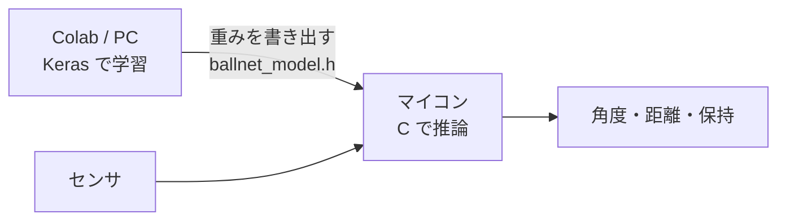

# 4-1 推論の中身は掛け算と足し算：C で動かす

## ねらい

- 学習したネットの重みを、マイコンで使える **C のヘッダ** に書き出せる
- ライブラリなしの短い C のコードで推論（予測の計算）ができ、それが Python と同じ答えになることを確かめられる
- Arduino / ESP32 のスケッチで、センサの値から角度・距離・保持をその場で推定できる

---

## 理論：学習と推論は別もの

ニューラルネットには2つの場面があります。

| 場面 | やること | どこでやるか |
|---|---|---|
| **学習** | 正解を見ながら重みを直す（勾配降下法、たくさんの計算） | PC や Colab |
| **推論** | 決まった重みで、入力から出力を計算するだけ | **マイコン** |

推論は、3-1 で NumPy で書いたとおり、**かけて足して ReLU** を層の数だけくり返すだけです。だから、マイコンでも短い C のコードで書けます。必要なのは、学習で決まった **重みとバイアスの数字** だけです。



---

## 手を動かす 1：学習して重みを取り出す

=== "Colab / ローカル"

    `notebooks/04_on_device.ipynb` に、第4部のコードが入っています（最初に 3-2 と同じ学習をします）。

    [](https://colab.research.google.com/github/Asg1223/rcj-soccer-ml/blob/main/notebooks/04_on_device.ipynb)

```python
import numpy as np
import keras
from rcjml import load_config
from rcjml.data import load_synthetic, split_by_session
from rcjml.nn import features, targets, evaluate, keras_loss, build_ballnet

cfg = load_config()
df = load_synthetic("ring12_large_normal")
train_all, test = split_by_session(df)
last = train_all.session.max()
train, val = train_all[train_all.session < last], train_all[train_all.session == last]

keras.utils.set_random_seed(0)
model = build_ballnet()                       # 12 → 64 → 64 → 4（3-2 と同じ）
model.compile(optimizer=keras.optimizers.Adam(1e-3), loss=keras_loss())
model.fit(features(train, cfg), targets(train),
          validation_data=(features(val, cfg), targets(val)),
          epochs=400, batch_size=64, verbose=0,
          callbacks=[keras.callbacks.EarlyStopping(patience=20, restore_best_weights=True)])

X_test = features(test, cfg)
P_keras = model.predict(X_test, verbose=0)
print(evaluate(P_keras, test))
```

重みは `layers_from_keras` で層ごとに取り出せます。

```python
from rcjml.export import layers_from_keras, forward

layers = layers_from_keras(model)
for k, L in enumerate(layers):
    print(f"層 {k}: 重み {L.W.shape}, バイアス {L.b.shape}, 活性化 {L.activation}")

# NumPy で同じ計算をして、Keras と同じ答えになるか確かめる
P_numpy = forward(layers, X_test)
print("Keras との差（いちばん大きいもの）:", np.abs(P_keras - P_numpy).max())
```

差が 0.00001 より小さければ、計算の中身は同じです（コンピュータの小数の丸め方の違いだけ）。

## 手を動かす 2：C のヘッダに書き出す

```python
from rcjml.config import PACKAGE_ROOT
from rcjml.export import export_to_sketch

sketch = PACKAGE_ROOT / "firmware" / "sensor-arduino" / "ballnet_infer"
files = export_to_sketch(model, sketch, allow_public=True)
for f in files:
    print(f, f.stat().st_size, "bytes")
```

`ballnet_model.h`（重み）と `rcjml_mlp.h`（推論の関数）が、スケッチのフォルダにできます。`ballnet_model.h` の中身は、こんな形です。

```c
#define BALLNET_N_IN 12
#define BALLNET_N_OUT 4
static const float ballnet_w0[768] RCJML_PROGMEM = { -1.2e-01f, 3.4e-01f, ... };
static const float ballnet_b0[64] RCJML_PROGMEM = { ... };
...
static inline void ballnet_forward(const float* in, float* out) { ... }
```

!!! private "自分のデータで学習したモデルは公開しない"
    `export_to_sketch` は、**公開リポジトリの中には書き出しません**（例の `allow_public=True` は、シミュレータのデータで練習するときだけ使います。書き出したファイルは `.gitignore` で除外されています）。
    自分のデータで学習したモデルを使うときは、スケッチのフォルダ（`firmware/sensor-arduino/ballnet_infer`）を **チーム用リポジトリにコピー** してから、そこに書き出します。

    ```python
    export_to_sketch(model, "~/rcj-soccer-ml-team/firmware/ballnet_infer")
    ```

    Colab で学習したときは、書き出したファイルをダウンロードします。

    ```python
    from google.colab import files
    files.download("ballnet_model.h")   # 書き出した場所に合わせる
    ```

## 手を動かす 3：C の推論の中身を読む

`firmware/common/rcjml_mlp.h` の中心は、1 層分の計算をする次の関数です。

```c
static inline void rcjml_dense(const rcjml_layer_t* L, const float* x, float* out) {
  for (uint16_t o = 0; o < L->n_out; o++) {          // 出力のニューロン 1 個ずつ
    float acc = 0.0f;
    const float* row = L->w + (uint32_t)o * L->n_in;
    for (uint16_t i = 0; i < L->n_in; i++)            // 入力を全部
      acc += rcjml_read_f(row + i) * x[i];            //   かけて足す
    acc += rcjml_read_f(L->b + o);                    // バイアスを足す
    out[o] = (L->act == RCJML_RELU && acc < 0.0f) ? 0.0f : acc;   // ReLU
  }
}
```

3-1 の `dense` 関数と同じことを、for 文で書いているだけです。`rcjml_read_f` は、Arduino Uno（AVR）では重みを **フラッシュメモリ** から読むための関数です（Uno は RAM が 2 KB しかないので、重みを RAM に置けません）。

## 手を動かす 4：PC で C の答え合わせ

C のコンパイラ（gcc）がある環境（Colab、Mac、Linux）なら、マイコンに書き込む前に PC で同じ答えになるかを確かめられます。

```python
import shutil, subprocess

if shutil.which("gcc") is None:
    print("gcc がないので、この確かめはとばします（Windows なら Colab で試せます）")
else:
    np.savetxt(sketch / "x_test.txt", X_test[:200])
    (sketch / "check.c").write_text(r'''
#include <stdio.h>
#include "ballnet_model.h"
int main(void) {
  FILE* f = fopen("x_test.txt", "r"); float x[BALLNET_N_IN], y[BALLNET_N_OUT];
  while (1) {
    for (int i = 0; i < BALLNET_N_IN; i++) if (fscanf(f, "%f", &x[i]) != 1) return 0;
    ballnet_forward(x, y);
    printf("%.7e %.7e %.7e %.7e\n", y[0], y[1], y[2], y[3]);
  }
}''')
    subprocess.run(["gcc", "-O2", "-o", "check", "check.c", "-lm"], cwd=sketch, check=True)
    out = subprocess.run(["./check"], cwd=sketch, capture_output=True, text=True).stdout
    P_c = np.array([[float(v) for v in line.split()] for line in out.splitlines()])
    print("C と Keras の差（いちばん大きいもの）:", np.abs(P_c - P_keras[:200]).max())
    for name in ["x_test.txt", "check.c", "check"]:
        (sketch / name).unlink()
```

教材の合成データで確かめたところ、差は **0.000006** で、角度の誤差も Keras とまったく同じ（5.8°）でした。

## 手を動かす 5：マイコンで動かす（実機）

1. `firmware/sensor-arduino/ballnet_infer/ballnet_infer.ino` を Arduino IDE で開きます（同じフォルダに、手を動かす 2 で書き出した2つのヘッダがあること）
2. いちばん上の「設定」を、1-2 の `ir_ring_reader` と同じにします
3. 書き込んで、シリアルモニタ（115200）を開きます

```text
BALL,15320,44.2,38.7,0.004,0.981,1532
```

左から、時刻、**角度**、**距離**、**保持の確率**、自信（7-2 で使う）、推論にかかった時間（µs）です。ボールを動かして、値がついてくるかを確かめます。

!!! warning "Arduino Uno で「容量が足りない」と出たら"
    このネットの重みは float で約 21 KB です。Uno のフラッシュは 32 KB なので、ほかのプログラムと合わせると入らないことがあります。そのときは、4-3 の **int8 にした重み**（約 5.6 KB）を使うか、ネットを小さく（`hidden=(32, 32)` など）して学習し直します。ESP32 なら、そのまま入ります。

---

## チェック問題

1. 学習と推論のうち、マイコンでやるのはどちらですか。それはなぜですか。
2. センサの値をネットに入れる前に、マイコン側でも 1023 で割るのはなぜですか。
3. 12 → 64 → 64 → 4 のネットで、1 回の推論に「かけて足す」は何回ありますか。

??? note "答え"
    1. 推論です。学習はたくさんの計算とデータが必要ですが、推論は決まった重みで計算するだけなので、マイコンでもできます。
    2. 学習のときに 0〜1 にそろえた値を入れていたからです。入力のそろえ方が学習と推論で違うと、まったく違う答えになります。
    3. 12 × 64 + 64 × 64 + 64 × 4 = 5,120 回です。

## つまずきポイント

??? failure "`ballnet_model.h: No such file or directory`"
    スケッチのフォルダに、書き出したヘッダがありません。手を動かす 2 をやり直し、`.ino` と同じフォルダに `ballnet_model.h` と `rcjml_mlp.h` があるか確かめます。

??? failure "マイコンの答えが PC と違う"
    いちばん多いのは、**入力のそろえ方の違い** です。センサの順番（s0 が正面、反時計回り）、値の範囲（0〜1023）、`BALLNET_INPUT_SCALE` を確かめます。センサの読み取り方（測る時間など）が学習データを集めたときと違う場合も、値がずれます。

??? failure "`static_assert ... センサの数とモデルの入力の数が違います`"
    スケッチの `SENSOR_PINS` の数と、学習したモデルの入力の数が違います。

## もっと深く

!!! deeper "重みの並べ方とメモリ"
    Keras の重みは「入力 × 出力」の形ですが、書き出すときに「出力 × 入力」に並べかえています。出力のニューロン 1 個分の重みがメモリ上で **となりあって並ぶ** ので、for 文で順に読むと速くなります（キャッシュが効く）。
    作業用の配列は、いちばん大きい層の幅（64）× 2 本だけで済みます。層の出力を2本の配列に交互に書くことで、何層あってもメモリが増えないようにしています。
