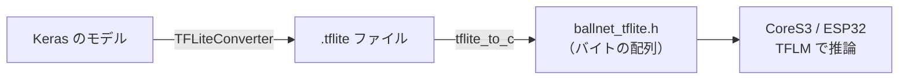

# 4-4 TensorFlow Lite Micro で動かす

## ねらい

- Keras のモデルを **TensorFlow Lite**（.tflite）の形に変換できる
- 全部 int8 に量子化したモデルを作り、成績と大きさを確かめられる
- **TensorFlow Lite Micro**（TFLM）で、ESP32 / CoreS3 の上でモデルを動かせる

---

## 理論：自作の推論と TFLM のちがい

4-1 では、全結合層だけの推論を自分で書きました。これは小さくて中身がよくわかりますが、**全結合層と ReLU しか使えません**。第6部のカメラ認識で使う **畳み込み層**（CNN）などは、自分で全部書くのは大変です。

**TensorFlow Lite Micro** は、マイコンでニューラルネットを動かすための、Google のライブラリです。

| | 自作（4-1） | TFLM（このページ） |
|---|---|---|
| 使える層 | 全結合 ＋ ReLU | 畳み込み、プーリングなど多数 |
| 動くマイコン | Uno でも動く | ESP32 / CoreS3 など、メモリが多めのもの |
| 量子化 | 重みだけ int8 | 全部 int8（速い） |
| 中身 | 全部読める | ライブラリにおまかせ |



---

## 手を動かす 1：.tflite に変換する

4-1 で学習した `model` を使います。

```python
import tensorflow as tf

# そのまま（float）
float_tflite = tf.lite.TFLiteConverter.from_keras_model(model).convert()

# 全部 int8。途中の値の範囲を測るために、学習用データの一部（代表データ）を渡す
def representative_data():
    X = features(train, cfg)
    for i in range(0, len(X), 20):
        yield [X[i:i + 1]]

conv = tf.lite.TFLiteConverter.from_keras_model(model)
conv.optimizations = [tf.lite.Optimize.DEFAULT]
conv.representative_dataset = representative_data
conv.target_spec.supported_ops = [tf.lite.OpsSet.TFLITE_BUILTINS_INT8]
int8_tflite = conv.convert()

print("float:", len(float_tflite), "バイト")
print("int8 :", len(int8_tflite), "バイト")
```

## 手を動かす 2：PC で成績を確かめる

変換したモデルを、PC の TFLite で動かして、成績が変わっていないか確かめます。

```python
def run_tflite(model_bytes, X):
    it = tf.lite.Interpreter(model_content=model_bytes)
    it.allocate_tensors()
    inp, out = it.get_input_details()[0], it.get_output_details()[0]
    P = []
    for x in X:
        it.set_tensor(inp["index"], x[None, :].astype(np.float32))
        it.invoke()
        P.append(it.get_tensor(out["index"])[0])
    return np.array(P)

for name, b in [("float", float_tflite), ("int8", int8_tflite)]:
    r = evaluate(run_tflite(b, X_test), test)
    print(f"{name:6s} 角度 {r['angle_MAE']:.2f}°  距離 {r['dist_rel_median']:.3f}  保持 {r['hold_acc']:.4f}")
```

| モデル | 角度 | 距離 | 保持 | 大きさ |
|---|---|---|---|---|
| Keras（元） | 5.77° | 14.8% | 99.5% | — |
| TFLite float | 5.77° | 14.8% | 99.5% | 22,980 バイト |
| TFLite int8 | 6.20° | 15.1% | 99.5% | 11,432 バイト |

int8 の .tflite は、モデルの構造の情報なども含むので、4-3 の「重みだけ」（5,648 バイト）より大きくなります。そのかわり、計算を全部整数でできます。

!!! note "入出力は float のまま"
    この変換では、中は int8 ですが、入力と出力は float のままにしています（モデルの最初と最後で自動で変換される）。スケッチ側は、4-1 と同じく 0〜1 の小数を入れるだけで使えます。

## 手を動かす 3：C の配列にする

```python
from rcjml.config import PACKAGE_ROOT
from rcjml.export import tflite_to_c

path = tflite_to_c(int8_tflite, PACKAGE_ROOT / "firmware" / "cores3" / "ballnet_tflm" / "ballnet_tflite.h")
print(path, path.stat().st_size, "バイト（文字にしたので元より大きい。書き込まれるのは元の大きさ）")
```

!!! private "自分のデータで学習したモデルは公開しない"
    `ballnet_tflite.h` も、`.gitignore` と pre-commit で公開リポジトリに入らないようにしてあります。自分のデータで学習したモデルは、スケッチのフォルダごとチーム用リポジトリにコピーして使います。

## 手を動かす 4：CoreS3 で動かす（実機）

1. Arduino IDE のライブラリマネージャで **ArduTFLite** を検索してインストールします（必要な **Chirale_TensorFlowLite** も一緒に入れるか聞かれたら、入れる）。M5Unified は 0-2 で入れたものを使います
2. `firmware/cores3/ballnet_tflm/ballnet_tflm.ino` を開きます（同じフォルダに `ballnet_tflite.h` があること）
3. ボードを **M5CoreS3** にして書き込みます
4. 画面に `BallNet (TFLM) ready` と出れば、モデルの読み込みは成功です

このスケッチは、まだセンサとつながっていないので、**シリアルから 1-2 と同じ形の行** を受け取って推論します。PC から試すには、1-3 のロガーで記録したデータを1行ずつ送ります。

??? example "PC から行を送って試すコード（CoreS3 がある人）"

    ```python
    import serial, time
    from rcjml.data import load_synthetic, sensor_columns

    port = "COM5"        # CoreS3 のポート（Mac なら /dev/cu.usbmodem…）
    d = load_synthetic("ring12_large_normal").sample(5, random_state=0)
    with serial.Serial(port, 115200, timeout=1) as ser:
        time.sleep(2)
        for _, row in d.iterrows():
            line = "IR,0," + ",".join(str(int(v)) for v in row[sensor_columns(d)]) + "\n"
            ser.write(line.encode())
            print("正解", row.angle_deg, row.distance_cm, "→", ser.readline().decode().strip())
    ```


第5部で、この入力を **センサ側のマイコンからの UART** に置きかえます。

---

## チェック問題

1. 自作の推論（4-1）ではなく TFLM を使いたくなるのは、どんなときですか。
2. 全部 int8 に変換するとき、代表データ（representative dataset）を渡すのはなぜですか。
3. `modelInit` が失敗しました。まず何を変えてみますか。

??? note "答え"
    1. 畳み込み層など、全結合層以外の層を使うとき（第6部のカメラ認識など）や、ESP32 の速い計算ライブラリを使って速くしたいときです。
    2. 途中の値（ReLU の出力など）がどれくらいの範囲になるかを測って、int8 の scale を決めるためです。
    3. `ARENA_SIZE`（TFLM が計算に使う RAM の大きさ）を増やします。

## つまずきポイント

??? failure "ArduTFLite のコンパイルでエラーになる"
    ボードが **M5CoreS3**（または ESP32）になっているか確かめます。Arduino Uno では TFLM は動きません。ライブラリのバージョンによって使えるボードが違うので、ライブラリの説明（README）の対応ボードも確かめます。

??? failure "PC の結果とマイコンの結果が少し違う"
    int8 では、計算の順番や丸め方の違いで、小さな差が出ることがあります。角度で 1° 以内くらいなら問題ありません。大きく違うときは、入力のそろえ方（0〜1）を確かめます。

## もっと深く

!!! deeper "TFLM のしくみと、ほかの選択肢"
    TFLM は、.tflite ファイルに書かれた「どの順番でどの計算をするか」を読んで、決まった大きさのメモリ（**テンソルアリーナ**）の中だけで計算します。マイコンでは、動いている途中でメモリを確保・解放すると、メモリがばらばらになって困るので、最初に全部決めておくのです。
    ESP32-S3 向けには、Espressif が作っている **ESP-DL** もあります。ESP32-S3 のベクトル命令に合わせて速く作られていて、第6部の物体検出（ESP-Detection）でも使われます。ESP-IDF という開発環境で使うので、Arduino IDE より少し難しくなります。
