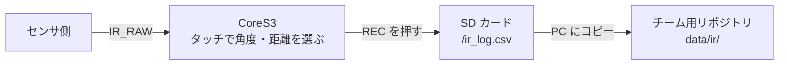

# 5-4 データ収集モード：コートで、PC なしで集める

## ねらい

- CoreS3 のタッチ画面で「角度・距離・保持・取り直し」を選び、SD カードにデータを記録できる
- 記録したデータを、1-5 以降のノートブックでそのまま使える

---

## 理論：本番に近い場所で集める

1-4 では、PC とロガーでデータを集めました。でも、本当に集めたいのは **大会の会場や、本番に近いコート** のデータです。そこに PC を広げるのは大変です。

CoreS3 には画面・タッチ・SD カードがあるので、**ロボットだけで** データを集められます。記録する形（列）は 1-3 のロガーと同じにしてあるので、あとで PC に移せば、同じノートブックで使えます。



---

## 手を動かす 1：スケッチを用意する

`firmware/cores3/collect/collect.ino` を使います。モデルは使わないので、共通のヘッダだけをコピーします。

```bash
python -m rcjml.export headers firmware/cores3/collect
```

スケッチの最初の設定で、センサの数（`N_SENSORS`）を自分の機体に合わせます。

## 手を動かす 2：集める

1. microSD カード（FAT32 でフォーマットしたもの）を CoreS3 に入れ、書き込みます
2. 画面の下のボタンで選びます

    | ボタン | 働き |
    |---|---|
    | `ANG-` / `ANG+` | 角度を 15° ずつ変える |
    | `DST-` / `DST+` | 距離を 3, 10, 20, 30, 45, 60, 80, 100, 130, 160 cm から選ぶ |
    | `SES-` / `SES+` | 取り直しの番号 |
    | `HOLD` | ボールを保持している状態にする（緑になる） |
    | `REC` | 今のセンサの値を 20 回記録する |

3. 1-4 の目印の上にボールを置き、画面の角度・距離を合わせて `REC` を押します
4. `saved 20 rows` と出たら、次の場所へ

!!! tip "1-4 の計画と組み合わせる"
    1-4 の `make_plan` で作った順番を紙に印刷して、上から順に集めると、抜けやかたよりがなくなります。

## 手を動かす 3：PC で読む

SD カードの `ir_log.csv` を、チーム用リポジトリの `data/ir/` にコピーします。ファイル名を変えたときは、読むときに指定します。

=== "チーム用の設定で"

    ```python
    from rcjml import load_config
    from rcjml.data import load_log

    cfg = load_config()                      # RCJML_CONFIG でチーム用の設定を指定しておく
    df = load_log(cfg, "ir_log.csv")         # data/ir/ir_log.csv
    df.groupby("session").size()
    ```

あとは、1-5 から同じ手順で使えます。

!!! private "SD カードの中身もチームの情報"
    SD カードに記録したデータは、実機のデータです。公開リポジトリには入れず、チーム用リポジトリかドライブに保存します。大会の会場で SD カードをなくさないように、記録したらすぐ PC にコピーしておきましょう。

---

## チェック問題

1. CoreS3 で記録したデータと、1-3 のロガーで記録したデータを、同じノートブックで使えるのはなぜですか。
2. 会場で 30 分だけデータを取れます。何に気をつけて集めますか。

??? note "答え"
    1. 列（`s0`〜、`angle_deg`, `distance_cm`, `has_ball`, `session`, `time`）を同じにしてあるからです。
    2. たとえば、取り直しの番号を会場用に新しくする、照明の条件（会場の照明、窓の近く）を変えて何回かに分ける、遠いボールと近いボールをかたよらずに集める、保持しているデータも入れる、などです。7-1 では、このような少ないデータでモデルを仕上げる方法を扱います。

## つまずきポイント

??? failure "`SD card not found` と出る"
    SD カードが FAT32 でフォーマットされているか、差しこみが浅くないかを確かめます。32 GB より大きいカードは、FAT32 にできないことがあります。

??? failure "`record FAILED` と出る"
    5 秒のあいだに 20 回分のパケットが届いていません。画面の `packets` の数が増えているか（センサ側とつながっているか）を確かめます。

## もっと深く

!!! deeper "時刻とファイルの管理"
    このスケッチは、時刻の列に「CoreS3 が起動してからのミリ秒」を書いています。CoreS3 には時計（RTC）があるので、日付と時刻を書くようにすると、あとで「どの日のデータか」がわかりやすくなります。取り直しごとにファイルを分けるのも、管理しやすい方法です。
