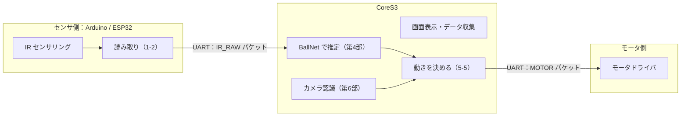

# 5-1 役割分担を決める

## ねらい

- センサ側のマイコンと CoreS3 に、どの仕事を任せるかを、理由をつけて決められる
- 2 台をつなぐ配線（UART）と、電圧の注意点がわかる

---

## 理論 1：なぜ 2 台に分けるのか

1 台のマイコンで全部やることもできますが、この教材では次の理由で 2 台に分けます。

| 理由 | 中身 |
|---|---|
| **時間の取り合い** | IR の読み取り（1-2）は、2.5 ms のあいだ CPU を使いきって測る。その間、カメラやモータの計算ができない |
| **ピンの数** | センサ 12 個、モータ、キッカー、ラインセンサ……と、ピンがすぐ足りなくなる |
| **得意なこと** | CoreS3 は画面・カメラ・タッチがあり、計算も速い。小さなマイコンは、決まった仕事を正確な時間でくり返すのが得意 |
| **壊れたときの切り分け** | 「センサ側は動いているが、CoreS3 側がおかしい」のように、問題の場所を見つけやすい |

## 理論 2：この教材の分担

| マイコン | 仕事 | 送るもの |
|---|---|---|
| センサ側（Arduino / ESP32） | IR センサリングを読む | センサの値（`IR_RAW`） |
| CoreS3 | 推定（BallNet）、カメラ、画面、動きを決める | モータの速さ（`MOTOR`） |
| モータ側 | モータを回す | — |

!!! tip "推定をセンサ側でやる選び方もある"
    第4部のとおり、BallNet はセンサ側（Arduino / ESP32）でも動きます。センサ側で推定して **結果（`BALL` パケット）だけ** を送ると、通信の量が減ります。一方、CoreS3 で推定すると、生の値が画面で見られ、データ集め（5-4）もしやすくなります。教材のスケッチは、どちらでも使えるようにしています（`ir_ring_uart` の `RUN_BALLNET`）。

モータ側は、センサ側と同じマイコンにまとめても構いません。チームの機体に合わせて決めてください。

---

## 手を動かす：配線する

UART は、**TX（送る）を相手の RX（受け取る）に**、**RX を相手の TX に** つなぎ、**GND をつなぐ** 3 本の配線です。

| センサ側 | CoreS3（Port C） |
|---|---|
| TX | RX（G18） |
| RX | TX（G17）（センサ側が受け取らないなら、なくてもよい） |
| GND | GND |

ESP32 は、スケッチの設定（`LINK_RX`, `LINK_TX`）でピンを決めます。Arduino Uno は 0 番（RX）・1 番（TX）を使います。

!!! warning "Arduino Uno（5V）と CoreS3（3.3V）を直接つながない"
    Uno の TX は 5V で、CoreS3 の入力は 3.3V までです。直接つなぐと CoreS3 が **壊れることがあります**。

    - Uno の TX → **分圧抵抗**（例：1 kΩ と 2 kΩ で 5V を約 3.3V に下げる）→ CoreS3 の RX
    - もっと安全にするなら、**レベル変換モジュール** を使う

    ESP32 どうし、ESP32 と CoreS3 なら、どちらも 3.3V なので直接つなげます。

!!! warning "Uno の 0・1 番ピンは USB と共用"
    Uno は、0・1 番ピンを USB のシリアルと共用しています。スケッチを書きこむときは、0・1 番の配線を外してください。デバッグ用に別のシリアルが欲しいときは、ESP32 を使うと楽です。

!!! note "CoreS3 のポートのピン"
    CoreS3 の Port C は G17・G18、Port B は G8・G9 です（[CoreS3 の説明書](https://docs.m5stack.com/en/core/coreS3)）。データが届かないときは、スケッチの RX と TX の番号を入れかえてみてください。

---

## チェック問題

1. IR の読み取りとモータの制御を、1 台のマイコンでやると困るのはなぜですか。
2. UART で、自分の TX は相手のどこにつなぎますか。
3. Uno と CoreS3 をつなぐとき、何に気をつけますか。

??? note "答え"
    1. IR の読み取りの 2.5 ms のあいだ CPU を使いきるので、その間モータの計算などができず、動きが遅れたりかくかくしたりするからです。
    2. 相手の RX です（送る口を受け取る口へ）。GND もつなぎます。
    3. 電圧の違い（5V と 3.3V）です。Uno の TX から CoreS3 の RX へは、分圧抵抗かレベル変換を入れます。

## もっと深く

!!! deeper "UART 以外の選択肢"
    - **I²C**：2 本の線で何台もつなげるが、速さは UART と同じくらいか遅い。センサをたくさんつなぐのに向く
    - **SPI**：4 本の線で、とても速い。カメラの画像のような大きなデータ向き
    - **CAN**：ノイズに強く、自動車でも使われる。モータの近くで長い線を引くときに向く
    - **ESP-NOW**：ESP32 どうしの無線。配線はいらないが、大会では無線のルールを必ず確かめる

    この教材の量（1 秒に数百回、1 回 30 バイトほど）なら、UART で十分です。
