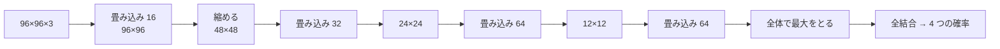

# 6-5 CNN：画像のためのニューラルネット

## ねらい

- **畳み込み**（小さな窓を画像の上ですべらせる計算）の仕組みがわかる
- Keras で小さな CNN を作り、「ボールは左・真ん中・右・なし」を分類できる
- 画像を縮めるタイミングが、小さな物の見つけやすさにどう効くかがわかる

---

## 理論 1：画像に全結合を使うとどうなるか

96 × 96 × 3 の画像を、第3部と同じ全結合層（64 個）に入れると、重みは 27,648 × 64 ＝ **約 177 万個** になります。しかも、画像の左上にあるボールと、右下にあるボールを、まったく別のものとして覚えなければなりません。

## 理論 2：畳み込み：小さな窓をすべらせる

**畳み込み層** は、3 × 3 くらいの小さな **窓（フィルタ）** を用意して、それを画像の上で少しずつずらしながら、窓の中の画素に重みをかけて足します。

- 1 つのフィルタは「オレンジの丸の縁」「緑から黒への境目」のような **小さな模様** を見つける係になる
- 同じフィルタを画像全体で使い回すので、**ボールがどこにあっても同じように見つけられる**
- 重みは 3 × 3 × 3（RGB）＝ 27 個 ＋ バイアスだけ。とても少ない

フィルタをたくさん用意し（16 個、32 個……）、層を重ねると、「小さな模様 → 丸 → ボール」のように、だんだん大きく複雑なものを見つけられるようになります。

## 理論 3：縮める（プーリング）

層を重ねながら、画像を少しずつ縮めます（**プーリング**。2 × 2 の中でいちばん大きい値を残すなど）。縮めると計算が減り、広い範囲を見渡せるようになります。

ただし、**縮めるのが早すぎると、小さな物が消えてしまいます**。遠くのボールは数画素しかないので、最初の層で一気に 1/4 にすると、ボールの情報がほとんど残りません。



---

## 手を動かす 1：データを用意する

ボールの位置で、画像を 4 つに分けます（0 = ボールなし、1 = 左、2 = 真ん中、3 = 右）。

```python
import numpy as np
import keras
from keras import layers
from rcjml.sim.camera import make_images, ball_position_class, HORIZON
from rcjml.vision import hsv_detect

X_train, L_train, _ = make_images(8000, seed=1)
X_val, L_val, _ = make_images(1000, seed=2)
X_test, L_test, _ = make_images(1000, seed=3)
to_class = lambda L: np.array([ball_position_class(b) for b in L])
y_train, y_val, y_test = to_class(L_train), to_class(L_val), to_class(L_test)
print("答えの数:", np.bincount(y_train))     # なし・左・真ん中・右
```

## 手を動かす 2：比べる相手を用意する

```python
majority = (y_test == np.bincount(y_train).argmax()).mean()
print(f"いつもいちばん多い答えを言う: {majority:.0%}")

def hsv_class(img):
    balls = [d for d in hsv_detect(img, horizon=HORIZON) if d.cls == 0]
    if not balls:
        return 0
    x = balls[0].cx
    return 1 if x < 32 else 2 if x < 64 else 3

print(f"色のしきい値（6-2）: {np.mean([hsv_class(x) == y for x, y in zip(X_test, y_test)]):.0%}")
```

## 手を動かす 3：CNN を作って学習する

```python
keras.utils.set_random_seed(0)
cnn = keras.Sequential([
    keras.Input((96, 96, 3)),
    layers.Rescaling(1 / 255),                                   # 0〜255 → 0〜1
    layers.Conv2D(16, 3, padding="same", activation="relu"), layers.MaxPooling2D(),   # 48×48
    layers.Conv2D(32, 3, padding="same", activation="relu"), layers.MaxPooling2D(),   # 24×24
    layers.Conv2D(64, 3, padding="same", activation="relu"), layers.MaxPooling2D(),   # 12×12
    layers.Conv2D(64, 3, padding="same", activation="relu"),
    layers.GlobalMaxPooling2D(),                                 # どこかにあれば大きな値になる
    layers.Dense(32, activation="relu"),
    layers.Dense(4, activation="softmax"),                       # 4 つの確率
])
cnn.compile(optimizer="adam", loss="sparse_categorical_crossentropy", metrics=["accuracy"])
cnn.fit(X_train, y_train, validation_data=(X_val, y_val), epochs=40, batch_size=64, verbose=0,
        callbacks=[keras.callbacks.EarlyStopping(patience=6, restore_best_weights=True)])
print(f"CNN: {cnn.evaluate(X_test, y_test, verbose=0)[1]:.0%}")
```

CPU だと 5 分ほどかかります。Colab なら「ランタイムのタイプ」を GPU にすると、ずっと速くなります。

| 方法 | 正解率 |
|---|---|
| いつも「いちばん多い答え」を言う | 39% |
| 色のしきい値（6-2） | 69% |
| 最初の層で一気に縮める CNN（下の「やってみよう」） | 58% |
| **このページの CNN** | **94%** |

## 手を動かす 4：まちがえた画像を見る

```python
import matplotlib.pyplot as plt
pred = cnn.predict(X_test, verbose=0).argmax(1)
wrong = np.where(pred != y_test)[0][:8]
names = ["none", "left", "center", "right"]
fig, axes = plt.subplots(1, len(wrong), figsize=(2.5 * len(wrong), 2.8))
for ax, i in zip(np.atleast_1d(axes), wrong):
    ax.imshow(X_test[i])
    ax.set_title(f"true {names[y_test[i]]}\npred {names[pred[i]]}", fontsize=8)
    ax.axis("off")
plt.show()
```

まちがえた画像の多くは、**とても遠くの小さなボール**、**ロボットに半分隠れたボール**、**左右の境目にあるボール** です。

!!! example "やってみよう"
    1. 最初の 2 つの層を `layers.Conv2D(16, 3, strides=2, ...)`（プーリングなしで一気に縮める）にすると、正解率はどうなるでしょう。教材では 58% まで落ちました。なぜでしょう。
    2. `GlobalMaxPooling2D` を `GlobalAveragePooling2D`（全体の平均）にかえると、どうなるでしょう。小さなボールが 1 つだけあるとき、平均と最大のどちらが残りやすいでしょう。

---

## チェック問題

1. 3 × 3 のフィルタ 16 個の畳み込み層（入力は RGB）の、重みとバイアスの数はいくつですか。
2. 畳み込み層が、ボールが画像のどこにあっても見つけられるのはなぜですか。
3. 遠くの小さなボールを見のがしやすいのは、CNN のどこで情報が失われるからですか。

??? note "答え"
    1. 3 × 3 × 3 × 16 + 16 = 448 個です。
    2. 同じフィルタを、画像のすべての場所で使い回して計算するからです。
    3. 縮める（プーリングや strides）ところです。数画素しかない物は、縮めるたびに周りに埋もれて消えやすくなります。

## つまずきポイント

??? failure "学習がとても遅い"
    画像のモデルは計算が多いので、CPU では時間がかかります。Colab の GPU を使うか、学習用の画像を 2,000 枚くらいに減らして試してから、本番の枚数で学習します。

??? failure "正解率が 39% のまま上がらない"
    「いつもいちばん多い答え」を言うだけになっています。学習率を下げる（`keras.optimizers.Adam(1e-4)`）、`Rescaling(1/255)` を入れ忘れていないか、などを確かめます。

## もっと深く

!!! deeper "CNN が見ているもの"
    学習した 1 層目のフィルタの重みを画像として描くと、「オレンジっぽい色」「明るさの境目」のような、簡単な模様になっていることが多いです。深い層ほど、もっと大きく複雑な形に反応するようになります。
    また、CNN の **受容野**（出力の 1 つが、入力画像のどれくらいの範囲を見ているか）は、層を重ねて縮めるほど広くなります。小さな物を見つけるには、縮めすぎずに受容野を広げる工夫（**dilated convolution** など）も使われます。
