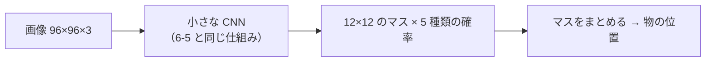

# 6-6 物体検出：ボール・ゴール・ロボットを同時に見つける

## ねらい

- 「画像のどこに何があるか」を出す **物体検出** の考え方がわかる
- **FOMO** の考え方（画像をマスに分けて、マスごとに「何の中心があるか」を当てる）で、小さな検出モデルを自分で作れる
- 本番用の 2 つのルート（Edge Impulse、ESP-Detection）の違いがわかる

---

## 理論 1：分類と検出のちがい

| | 答え | 例 |
|---|---|---|
| **分類**（6-5） | 画像全体に 1 つの答え | 「ボールは左」 |
| **検出**（このページ） | 物ごとに「種類」と「位置」 | 「ボールが (40, 70)、ロボットが (20, 50)」 |

ボール・ゴール・ロボットが同時に写っている画像では、検出が必要です。

## 理論 2：FOMO の考え方

物体検出には、物を囲む枠をぴったり当てる方法（YOLO など）もありますが、マイコンでは計算が重くなります。ロボットに必要なのは、多くの場合「**どの方向に、何があるか**」です。枠の大きさまでは要りません。

そこで、Edge Impulse の **FOMO**（Faster Objects, More Objects）の考え方を使います。

1. 96 × 96 の画像を、**12 × 12 のマス**（1 マス 8 × 8 画素）に分ける
2. マスごとに「何もない・ボール・黄ゴール・青ゴール・ロボット」の 5 つのどれかを当てる（マスごとの **分類**）
3. 物の **中心があるマス** に、その物の種類を答えとして付ける
4. となりあった同じ種類のマスは、1 つの物としてまとめる



マスのほとんどは「何もない」なので、そのまま学習すると「全部なし」と答えるだけのモデルになりがちです。そこで、**物のあるマスの損失を 20 倍に重くして** 学習します（3-4 の不均衡データの話と同じです）。

---

## 手を動かす 1：データを作る

```python
import numpy as np
import keras
import matplotlib.pyplot as plt
from rcjml.sim.camera import make_images, CLASSES, centroid_grid
from rcjml.vision import build_fomo, fomo_loss, fomo_detections, grid_targets, evaluate, hsv_detect

X_train, L_train, _ = make_images(8000, seed=1)
X_val, L_val, _ = make_images(1000, seed=2)
X_test, L_test, _ = make_images(1000, seed=3)

print(centroid_grid(L_train[0]))        # 1 枚目の正解のマス（0 = 何もない、1〜4 = 種類）
```

## 手を動かす 2：学習する

```python
keras.utils.set_random_seed(0)
fomo = build_fomo()
fomo.summary()
fomo.compile(optimizer=keras.optimizers.Adam(2e-3), loss=fomo_loss(object_weight=20.0))
fomo.fit(X_train, grid_targets(L_train),
         validation_data=(X_val, grid_targets(L_val)),
         epochs=40, batch_size=64, verbose=0,
         callbacks=[keras.callbacks.EarlyStopping(patience=5, restore_best_weights=True)])
```

パラメータは約 72,000 個です。CPU で 3 分ほどかかります（Colab の GPU なら 1 分くらい）。

## 手を動かす 3：成績を測る

```python
P = fomo.predict(X_test, verbose=0)
preds = [fomo_detections(p, threshold=0.5) for p in P]
r = evaluate(preds, L_test)
for cls, v in r.items():
    print(f"{cls:12s} 見つけた {v['recall']:.0%}  当たった {v['precision']:.0%}")
```

| | 色のしきい値（6-2、場所をしぼったもの） | FOMO 風の検出 |
|---|---|---|
| ボール | 見つけた 77%・当たった 59% | 見つけた **98%**・当たった **87%** |
| 黄ゴール | 99%・52% | 98%・92% |
| 青ゴール | 94%・41% | 98%・97% |
| ロボット | **0%**・— | 見つけた **91%**・当たった **93%** |

色では見つけられなかったロボットも、9 割見つけられるようになりました。`difficulty="hard"` の画像（照明やぼけが強い）でも、ボール 96%・ロボット 91% を見つけます。

結果を描いて確かめます。

```python
COLORS = ["orange", "gold", "blue", "red"]
fig, axes = plt.subplots(2, 4, figsize=(12, 6))
for ax, img, ps in zip(axes.flat, X_test[:8], preds[:8]):
    ax.imshow(img)
    for p in ps:
        ax.plot(p.cx, p.cy, "o", mfc="none", mec=COLORS[p.cls], ms=12, mew=2)
    ax.axis("off")
plt.tight_layout()
plt.show()
```

## 手を動かす 4：マイコン用に書き出す

4-4 と同じく、int8 の TensorFlow Lite にして、C の配列にします。

```python
import tensorflow as tf
from rcjml.config import PACKAGE_ROOT
from rcjml.export import tflite_to_c

def representative_images():
    for i in range(0, 400, 4):
        yield [X_train[i:i + 1].astype(np.float32)]

conv = tf.lite.TFLiteConverter.from_keras_model(fomo)
conv.optimizations = [tf.lite.Optimize.DEFAULT]
conv.representative_dataset = representative_images
conv.target_spec.supported_ops = [tf.lite.OpsSet.TFLITE_BUILTINS_INT8]
fomo_int8 = conv.convert()
print("int8 のモデル:", len(fomo_int8), "バイト")

path = tflite_to_c(fomo_int8, PACKAGE_ROOT / "firmware" / "cores3" / "camera_detect" / "fomo_tflite.h",
                   name="fomo_tflite")
```

int8 のモデルは約 **85 KB** です。PC の TFLite で確かめると、成績は float とほぼ同じ（ボール 98%、ロボット 92%）でした。

!!! private "自分の画像で学習したモデルは公開しない"
    `fomo_tflite.h` も、自分の画像で学習したものはチーム用リポジトリに置きます。

## 手を動かす 5：CoreS3 で動かす（実機）

`firmware/cores3/camera_detect/camera_detect.ino` を書き込みます（4-4 の ArduTFLite と、6-3 の M5CoreS3 のライブラリを使います）。画面にカメラの映像が出て、見つけた物の位置に色つきの丸が描かれます。シリアルには、

```text
CAM,52310,ball,12.5,0.93
```

のように、種類・**角度**（左が ＋）・確率が送られます。角度は 6-9 で IR と合わせるのに使います。

!!! warning "シミュレータで学習したモデルは、そのままでは実機で動かない"
    シミュレータの画像は、本物のカメラの画像と見た目が違うので、このモデルで本物のボールはほとんど見つけられません。**6-3・6-4 で集めた自分の画像** で、同じ手順で学習し直してください（`load_yolo_folder` で読みこんだ `X`, `labels` を使う）。

---

## 本番のための 2 つのルート

自分でここまで作れたら、仕組みはわかったことになります。本番では、次のどちらかを使うと便利です。

### ルート A：Edge Impulse の FOMO（中高生向けの本線）

Edge Impulse は、ブラウザでデータの管理・学習・マイコン用の書き出しまでできるサービスです。無料の Developer プランで使えます。

1. Edge Impulse にアカウントを作り、プロジェクトを作る（**必ず Private**。Public にすると、画像もモデルも公開される）
2. 6-4 で付けたラベルごと画像をアップロードする
3. 「Impulse design」で画像のサイズを 96 × 96、学習のブロックで **FOMO** を選ぶ
4. 学習して、テスト用の画像で成績を確かめる
5. 「Deployment」で **Arduino library** を選んで書き出し、Arduino IDE に入れて使う

!!! private "Edge Impulse を使うときの注意"
    - プロジェクトは **Private** で作る。無料プランでは Private プロジェクトの数に上限があるので、使わなくなったプロジェクトは整理する
    - 知り合いのチームのロボットの画像を上げるときは、そのチームの了承をもらう（6-8）

### ルート B：ESP-DL / ESP-Detection（もっと深く）

Espressif の **ESP-Detection** は、YOLO 系の小さなモデルを、ESP32-S3 などで速く動かすためのものです。枠の大きさも出せて、ESP32-S3 でも 224 × 224 の画像で 1 秒に 7 枚以上動くとされています。ESP-IDF（Espressif の開発環境）と Python の学習環境が必要なので、Arduino IDE より難しくなりますが、精度と速さを両方求めるならこちらです。

---

## チェック問題

1. FOMO で、12 × 12 のマスのうち、ボールの中心があるマスだけを「ボール」とするのはなぜですか。
2. 物のあるマスの損失を重くしないと、どんなモデルになりやすいですか。
3. シミュレータの画像で学習したモデルを、本物のカメラで使うとどうなりますか。

??? note "答え"
    1. 枠の大きさを当てなくてよいぶん、計算が軽くなり、マイコンで速く動かせるからです。ロボットに必要なのは「どの方向に何があるか」なので、中心の位置がわかれば十分なことが多いです。
    2. 144 マスのうち物があるのは数マスなので、「全部なし」と答えるだけで損失がかなり小さくなってしまい、何も見つけないモデルになりやすいです。
    3. 見た目が違うので、ほとんど見つけられません。自分のカメラで撮った画像で学習し直す必要があります。

## つまずきポイント

??? failure "何も見つけない（全部「なし」）"
    `fomo_loss(object_weight=...)` を大きくします。学習用の画像に、物がちゃんと写っているかも確かめます。

??? failure "CoreS3 で `modelInit failed`"
    CNN は全結合より多くのメモリを使います。スケッチの `ARENA_SIZE` を増やします（PSRAM に置いているので、数百 KB まで増やせます）。

## もっと深く

!!! deeper "マスの大きさと、小さな物"
    1 マスが 8 × 8 画素なので、2 つの物の中心が同じマスに入ると、1 つにまとめられてしまいます。また、遠くの小さなボールは、CNN の途中で画像を縮めていくうちに消えてしまうことがあります。
    入力の解像度を上げる（96 → 160）、マスを細かくする、などで改善できますが、計算は増えます。どこまで必要かは、「ロボットがボールを見つけたい距離」から逆算して決めます。
