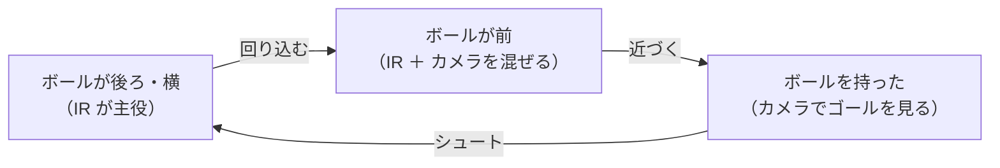

# 6-9 IR とカメラを組み合わせる

## ねらい

- IR とカメラの、得意なこと・苦手なことを整理する
- 2 つの角度の推定を **重みつき平均** で 1 つにまとめられる
- 試合の動きの中で、どちらをどう使うかを決められる

---

## 理論 1：得意・苦手

| | IR リング（第2〜5部） | カメラ（第6部） |
|---|---|---|
| 見える範囲 | **全方向（360°）** | 前だけ（CoreS3 なら左右 約 60°） |
| 角度の細かさ | 粗い（平均で 5〜6° ずれる） | **細かい（約 1°）** |
| 距離 | 明るさからだいたい | 画像の中の大きさ・高さから |
| ボール以外 | 見えない | **ゴール・相手ロボットも見える** |
| 速さ | 速い（1 ms 以下） | 遅い（数十 ms） |
| 苦手 | 反射、ほかの IR | 照明、隠れ、ぼけ |

まとめると、**IR は「どっちにあるか」を、カメラは「正確にどこにあるか」と「周りに何があるか」** を教えてくれます。

## 理論 2：重みつき平均

2 つの推定を混ぜるとき、**ずれの小さいほうを重く** します。それぞれのずれの大きさ（標準偏差）を σ<sub>IR</sub>、σ<sub>cam</sub> とすると、重みは「ずれの 2 乗の逆数」にします。

$$
w_\text{IR} = \frac{1}{\sigma_\text{IR}^2}, \qquad w_\text{cam} = \frac{1}{\sigma_\text{cam}^2}
$$

角度は 359° と 1° の平均が 180° にならないように、第1部と同じく **cos と sin にしてから平均** します。

$$
\hat\theta = \operatorname{atan2}\left(w_\text{IR}\sin\theta_\text{IR} + w_\text{cam}\sin\theta_\text{cam},\; w_\text{IR}\cos\theta_\text{IR} + w_\text{cam}\cos\theta_\text{cam}\right)
$$

カメラにボールが映っていないときは、IR だけを使います。

---

## 手を動かす 1：IR の推定を用意する

第3部の BallNet を学習し、テストデータの角度を推定します。

```python
import numpy as np
import keras
from rcjml import load_config
from rcjml.data import load_synthetic, split_by_session
from rcjml.nn import features, targets, keras_loss, build_ballnet, decode
from rcjml.sim import angle_error_deg
from rcjml.sim.camera import render, angle_from_x, FOV_DEG
from rcjml.vision import fomo_detections

cfg = load_config()
df = load_synthetic("ring12_large_normal")
train, test = split_by_session(df)
last = train.session.max()
fit, val = train[train.session < last], train[train.session == last]

keras.utils.set_random_seed(0)
ballnet = build_ballnet()
ballnet.compile(optimizer=keras.optimizers.Adam(1e-3), loss=keras_loss())
ballnet.fit(features(fit, cfg), targets(fit), validation_data=(features(val, cfg), targets(val)),
            epochs=400, batch_size=64, verbose=0,
            callbacks=[keras.callbacks.EarlyStopping(patience=20, restore_best_weights=True)])

ir = decode(ballnet.predict(features(test, cfg), verbose=0))["angle_deg"]
true = test.angle_deg.values
```

## 手を動かす 2：同じ場面のカメラ画像を作る

テストデータのうち、ボールがカメラの前（±30°）にある場面について、同じ角度・距離にボールを置いた画像を作り、6-6 の検出モデル `fomo` で角度を求めます。

```python
rng = np.random.default_rng(0)
in_view = (np.abs(true) < FOV_DEG / 2) & (test.has_ball.values == 0)
idx = np.where(in_view)[0]
imgs = np.stack([render(rng, ball_at=(true[i], test.distance_cm.values[i]))[0] for i in idx])
P = fomo.predict(imgs, verbose=0)          # fomo は 6-6 で学習したもの

cam = np.full(len(test), np.nan)           # 見つからなければ NaN
for k, i in enumerate(idx):
    balls = [d for d in fomo_detections(P[k], 0.5) if d.cls == 0]
    if balls:
        guesses = [angle_from_x(d.cx) for d in balls]
        # ボールが 2 つ見えたら（反射など）、IR の角度に近いほうを選ぶ
        cam[i] = min(guesses, key=lambda a: abs((a - ir[i] + 180) % 360 - 180))

seen = ~np.isnan(cam)
print(f"前にある場面 {in_view.sum()} 個のうち、カメラで見つけた {seen.sum() / in_view.sum():.0%}")
```

## 手を動かす 3：混ぜる

```python
def fuse(ir_deg, cam_deg, s_ir=6.0, s_cam=1.5):
    out = ir_deg.copy()
    ok = ~np.isnan(cam_deg)
    w1, w2 = 1 / s_ir**2, 1 / s_cam**2
    a1, a2 = np.deg2rad(ir_deg[ok]), np.deg2rad(cam_deg[ok])
    out[ok] = np.rad2deg(np.arctan2(w1 * np.sin(a1) + w2 * np.sin(a2),
                                    w1 * np.cos(a1) + w2 * np.cos(a2)))
    return out

fused = fuse(ir, cam)
mae = lambda est, mask: angle_error_deg(est[mask], true[mask]).mean()
print(f"前にある場面: IR {mae(ir, in_view):.1f}°  カメラ {mae(cam, seen):.1f}°  混ぜた {mae(fused, in_view):.1f}°")
everywhere = np.ones(len(test), bool)
print(f"全部の場面:   IR {mae(ir, everywhere):.1f}°  混ぜた {mae(fused, everywhere):.1f}°")
```

| 場面 | IR だけ | カメラ（見つけたときだけ） | 混ぜた |
|---|---|---|---|
| ボールが前（±30°） | 5.3° | 1.0° | **1.8°** |
| 全部の場面 | 5.8° | —（前しか見えない） | **5.2°** |

- 前にあるときは、平均のずれが 5.3° から 1.8° に小さくなりました。「混ぜた」が 1.0° にならないのは、カメラが見つけられなかった 12% の場面で IR を使っているからです。
- 全部の場面では少ししか良くなりません。ボールが後ろや横にあるときは、カメラでは見えないからです。

!!! example "やってみよう"
    `s_cam` を 6.0（IR と同じ）にすると、混ぜた結果はどうなるでしょう。カメラの角度を「信じすぎない」と、どれくらい損をするでしょう。

---

## 理論 3：試合の動きの中での使い分け

数字で比べるより大事なのは、**場面ごとにどちらを主役にするか** です。



1. **ボールが後ろや横**：IR だけで回り込みます（第5部 5-5 の追いかけ）。
2. **ボールが前**：IR とカメラを混ぜて、正確にまっすぐ近づきます。
3. **ボールを持った**：カメラで **相手ゴールの位置** と **ゴール前の相手ロボット** を見て、空いているほうへ向かいます。

!!! tip "実機で混ぜるとき"
    - IR は 1 ms ごと、カメラは 30〜50 ms ごとに新しい値が来ます。カメラの値が **古くなったら（例：100 ms 以上）使わない** ようにします。
    - カメラはロボットの前を向いているので、カメラの角度（画面の中の位置）を、ロボットの向きを 0° とする角度に直してから混ぜます。カメラがまっすぐ前を向いていないときは、そのずれを足します。
    - σ<sub>IR</sub> と σ<sub>cam</sub> は、自分のロボットで測ったずれの大きさを使います。この値は **非公開**（`configs/robot.yaml`）に置きます。

---

## チェック問題

1. IR は粗いのに、カメラだけにしないのはなぜですか。
2. σ<sub>IR</sub> = 6°、σ<sub>cam</sub> = 1.5° のとき、カメラの重みは IR の何倍ですか。
3. カメラにボールが 2 つ映ったとき、どちらを選ぶとよいですか。

??? note "答え"
    1. カメラは前しか見えないからです。後ろや横のボールは IR でしか見つけられません。
    2. (6 / 1.5)² = 16 倍です。
    3. IR の角度に近いほうです。床やかべに映ったボールなど、にせ物のことがあります。

## つまずきポイント

??? failure "混ぜたら、ロボットがふらふらする"
    カメラの値が来た瞬間と来ないときで、角度がぱっと切り替わっているかもしれません。カメラの重みを少しずつ増やす、または 7-4 の追跡（なめらかにする工夫）と組み合わせます。

??? failure "カメラの角度が、いつも数度ずれている"
    カメラの取り付けが少し傾いています。ボールを真正面に置いたときのカメラの角度を測って、その分を引きます（第7部 7-1 の調整と同じ考え方です）。

## もっと深く

!!! deeper "カルマンフィルタとセンサ融合"
    このページの重みつき平均は、**カルマンフィルタ** の 1 回分の更新と同じ形をしています。カルマンフィルタは、これに「前の時刻からの予測」を組み合わせ、それぞれのずれの大きさを時間とともに更新します。角度のように回る量では、拡張カルマンフィルタや、角度専用の分布（フォン・ミーゼス分布）を使う方法もあります。
    また、2 つのセンサの値をそのまま 1 つのニューラルネットに入れて学習する方法（**early fusion**）もあります。ただし、カメラが見えないときの扱いや、データを同じ時刻にそろえる作業が難しくなります。
