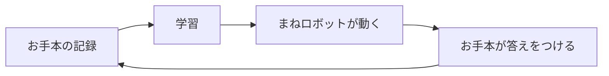

# 7-3 模倣学習：お手本の動きをまねる

## ねらい

- 「どう動くか」も、データから学習できることを知る（**模倣学習**、behavior cloning）
- お手本の数が少ないと、まねがうまくいかないことを確かめる
- まねしたロボットが自分で動いたデータにお手本の答えをつける **DAgger** を試す

---

## 理論 1：「見たもの → 動き」も関数

第3部では「センサの値 → ボールの角度・距離」を学習しました。5-5 では、その角度・距離から「進む向き・速さ」を **人が考えた規則**（回り込み）で決めました。

この「見たもの → 動き」の部分も、データから学習できます。

| | 入力 | 出力（答え） |
|---|---|---|
| 第3部 | センサの値 | ボールの角度・距離 |
| この章 | ボールの角度・距離、保持しているか、ゴールの角度 | 進む向き・速さ |

答え（お手本の動き）は、**上手な人がロボットを操縦したときの記録** から作れます。この章では、人の代わりに 5-5 の回り込みの規則をお手本にします。

## 理論 2：まねのずれは、たまっていく

まねするロボットは、少しだけお手本とずれた動きをします。するとお手本が行ったことのない場所（ボールの真横に近すぎる、など）に入りこみ、そこでの動き方は習っていないので、さらにずれます。**ずれがたまっていく** のが、模倣学習のむずかしいところです。

**DAgger**（Dataset Aggregation）は、これを次の手順で減らします。

1. お手本の記録で学習する
2. **まねしたロボットに自分で動いてもらい**、そのとき見たものを記録する
3. 記録した場面に「お手本ならこう動く」という答えをつける
4. 1 のデータに足して、学習し直す（2〜4 をくり返す）



---

## 手を動かす 1：入力と答えを決める

```python
import numpy as np
import keras
from rcjml.sim.field import chase_rule, rollout, success_rate, MAX_SPEED
from rcjml.export import layers_from_keras, forward

def expert(o):                      # お手本（5-5 の回り込み）
    return chase_rule(o["angle_deg"], o["distance_cm"], o["holding"], o["goal_angle_deg"])

def feat(o):                        # 入力：角度は cos と sin に（第1部）
    a, g = np.deg2rad(o["angle_deg"]), np.deg2rad(o["goal_angle_deg"])
    return [np.cos(a), np.sin(a), np.log(max(o["distance_cm"], 1)) / 5,
            float(o["holding"]), np.cos(g), np.sin(g)]

def targ(action):                   # 答え：進む向き（cos, sin）と速さ（0〜1）
    direction, speed = action
    t = np.deg2rad(direction)
    return [np.cos(t), np.sin(t), speed / MAX_SPEED]

print(success_rate(expert, n=200, seed=100))    # お手本の成績
```

お手本は 200 本中 200 本ゴールし、ゴールまで平均 45 ステップ（2.2 秒）です。

## 手を動かす 2：お手本を記録して、まねを学習する

```python
def collect(policy, n_episodes, seed, teacher=None):
    rng = np.random.default_rng(seed)
    X, Y = [], []
    for _ in range(n_episodes):
        _, observations, actions = rollout(policy, rng, teacher=teacher)
        X += [feat(o) for o in observations]
        Y += [targ(a) for a in actions]
    return np.array(X, np.float32), np.array(Y, np.float32)

def train(X, Y, seed=0):
    keras.utils.set_random_seed(seed)
    m = keras.Sequential([keras.Input((6,)),
                          keras.layers.Dense(64, activation="relu"),
                          keras.layers.Dense(64, activation="relu"),
                          keras.layers.Dense(3)])
    m.compile(optimizer=keras.optimizers.Adam(1e-3), loss="mse")
    m.fit(X, Y, epochs=60, batch_size=256, verbose=0, validation_split=0.1,
          callbacks=[keras.callbacks.EarlyStopping(patience=6, restore_best_weights=True)])
    return layers_from_keras(m)      # 速く動かすため、第4部の NumPy の推論を使う

def as_policy(layers):
    def policy(o):
        y = forward(layers, np.array([feat(o)], np.float32))[0]
        return float(np.rad2deg(np.arctan2(y[1], y[0]))), float(np.clip(y[2], 0, 1) * MAX_SPEED)
    return policy

X, Y = collect(expert, 50, seed=1)
student = as_policy(train(X, Y))
print("お手本 50 本でまねしたロボット:", success_rate(student, n=200, seed=100))
```

`rollout()` は 1 本走らせて、見たものと動きを記録する関数です。`teacher` を渡すと、**動かすのは policy、記録するのは teacher の答え** になります（DAgger で使います）。

## 手を動かす 3：お手本の数と DAgger

```python
for seed in [0, 1, 2]:
    bc, dagger = [], []
    for n in [10, 20, 30, 40]:                                      # お手本だけ
        X, Y = collect(expert, n, seed=1 + seed * 100)
        bc.append(success_rate(as_policy(train(X, Y, seed)), n=200, seed=100)["goal_rate"])
    X, Y = collect(expert, 10, seed=1 + seed * 100)                  # DAgger：お手本 10 本から
    layers = train(X, Y, seed)
    dagger.append(success_rate(as_policy(layers), n=200, seed=100)["goal_rate"])
    for it in range(1, 4):                                          # 10 本ずつ足す
        Xn, Yn = collect(as_policy(layers), 10, seed=10 + it + seed * 100, teacher=expert)
        X, Y = np.vstack([X, Xn]), np.vstack([Y, Yn])
        layers = train(X, Y, seed)
        dagger.append(success_rate(as_policy(layers), n=200, seed=100)["goal_rate"])
    print(f"seed {seed}: お手本だけ {bc}  DAgger {dagger}")
```

3 分ほどかかります。乱数をかえて 3 回やった平均のゴール率です。

| 記録した本数 | お手本だけ | DAgger（お手本 10 本 ＋ 自分で動いた分） |
|---|---|---|
| 10 本 | 48%（2〜80% とばらばら） | 48%（同じ） |
| 20 本 | 92% | **97%** |
| 30 本 | 98% | 98% |
| 40 本 | 99% | **100%** |

- **お手本が少ないと、まねは不安定** です。10 本だと、乱数によって 2% から 80% まで大きく変わりました。
- 同じ本数なら、DAgger のほうが少し良くなりました。まねロボットが **自分で迷いこんだ場面** の答えを習えるからです。この課題は簡単なので差は小さいですが、相手ロボットがいる、ボールが動く、などむずかしくなるほど差が大きくなります。

## 手を動かす 4：お手本が下手だったら

人の操縦は、毎回少しずつぶれます。お手本の向きに ±20° のぶれを入れ、速さも少し落とします。

```python
rng_noise = np.random.default_rng(5)
def noisy_expert(o):
    d, s = expert(o)
    return d + rng_noise.normal(0, 20), s * rng_noise.uniform(0.7, 1.0)

X, Y = collect(noisy_expert, 200, seed=1)
student = as_policy(train(X, Y))
print("ぶれたお手本:", success_rate(noisy_expert, n=200, seed=100))
print("それをまねたロボット:", success_rate(student, n=200, seed=100))
```

| | ゴール率 | ゴールまでの平均ステップ |
|---|---|---|
| ぶれたお手本 | 100% | 56.9 |
| それをまねたロボット | 100% | **53.6** |

まねしたロボットのほうが、少し速くゴールしました。たくさんのお手本を平均して覚えるので、**毎回のぶれが打ち消される** からです。ただし、いつも同じ方向にずれるくせ（いつも右に回りすぎる、など）は、そのまままねしてしまいます。

!!! tip "実機で人のお手本を集めるには"
    - CoreS3 のタッチ画面やゲームパッドでロボットを操縦し、**IR の推定（角度・距離・自信）と、そのときの操縦（向き・速さ）** を 20 Hz くらいで SD に記録します（5-4 のデータ収集モードと同じしくみ）。
    - 下手な場面（ボールをコートの外に出した、など）は、記録から消してから学習します。
    - まねしたモデルは、いきなり試合で使わず、まずは **規則と比べて、ずれが大きい場面を調べる** 道具として使うのもおすすめです。
    - 操縦の記録も、チームの大事なデータです。非公開リポジトリに置きます。

---

## チェック問題

1. この章の模倣学習の「入力」と「答え」は何ですか。
2. まねしたロボットが、お手本が行かない場所に入りこむと、なぜ困るのですか。
3. DAgger で、まねロボットが動いたときの答えは、だれがつけますか。

??? note "答え"
    1. 入力はボールの角度・距離、保持しているか、ゴールの角度。答えはお手本の進む向きと速さです。
    2. その場所での動き方を習っていないので、さらにずれた動きをし、ずれがたまっていくからです。
    3. お手本（この章では規則、実機なら人）です。人の場合は、記録した映像やログを見ながら「ここではこう動くべき」と答えをつけます。

## つまずきポイント

??? failure "まねしたロボットが、ボールの周りをぐるぐる回る"
    向きを角度そのもの（−180〜180）で学習していませんか。−179° と 179° はほぼ同じ向きなのに、数字では大きく違います。cos と sin で学習します（第1部と同じ）。

??? failure "学習の誤差は小さいのに、走らせるとゴールしない"
    学習の誤差は「お手本が通った場面」でしか測っていません。本当の成績は、**まねロボットを走らせて** 測ります（この章の `success_rate`）。

## もっと深く

!!! deeper "模倣学習から強化学習へ"
    DAgger は、まねのずれがたまる問題（**共変量シフト**）を理論的に抑えられることが示されています（Ross らの研究）。
    お手本なしで、**ゴールしたらほうび** という形で動き方を学ぶのが **強化学習** です。このコートのシミュレータは強化学習の練習にも使えます。ただし、ほうびだけから学ぶには何万本もの試行が必要なので、まず模倣学習で始めて、強化学習で磨く、という組み合わせがよく使われます。シミュレータで学習した動きを実機に持っていくときは、**sim-to-real** の差（モータの遅れ、すべり）が問題になります。
