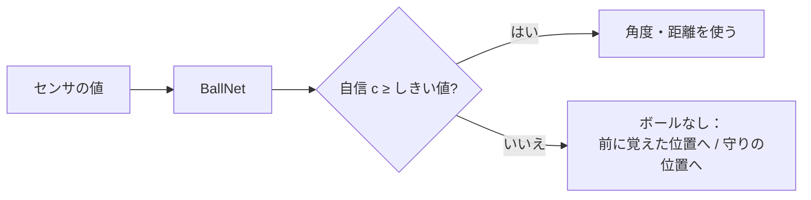

# 7-2 ボールがないとき：自信のないときは「わからない」と言う

## ねらい

- ボールがないときでも、モデルが自信満々に角度を答えてしまうことを確かめる
- 「ボールなし」のデータを学習に混ぜて、**自信（confidence）** で見分けられるようにする
- しきい値を決めて、ロボットの動きに使えるようにする

---

## 理論 1：モデルはいつも何かを答える

第3部の BallNet は、12 個のセンサの値を入れると、**必ず** 角度を出します。ボールがコートの外に出たとき、相手に完全に隠れたとき、ほかのロボットの赤外線しか入っていないときでも、です。

BallNet の出力のうち、角度は (cos θ, sin θ) の 2 つで表していました。この 2 つの **長さ**

$$
c = \sqrt{\cos^2 + \sin^2}
$$

を **自信**（confidence）として使えます。ボールがあるデータだけで学習すると、出力の長さはいつもほぼ 1 です。そこで、**ボールがないデータの答えを (0, 0)** にして学習すると、「わからないときは長さを 0 に近づける」ことを覚えます。



---

## 手を動かす 1：今のモデルに「ボールなし」を見せる

```python
import numpy as np
import pandas as pd
import keras
from rcjml import load_config
from rcjml.data import load_synthetic, split_by_session
from rcjml.nn import features, targets, keras_loss, build_ballnet, decode, evaluate
from rcjml.sim import make_no_ball

cfg = load_config()
df = load_synthetic("ring12_large_normal")
train, test = split_by_session(df)
last = train.session.max()
fit, val = train[train.session < last], train[train.session == last]

def train_ballnet(trn, val, make_targets=targets, seed=0):
    keras.utils.set_random_seed(seed)
    m = build_ballnet()
    m.compile(optimizer=keras.optimizers.Adam(1e-3), loss=keras_loss())
    m.fit(features(trn, cfg), make_targets(trn), validation_data=(features(val, cfg), make_targets(val)),
          epochs=400, batch_size=64, verbose=0,
          callbacks=[keras.callbacks.EarlyStopping(patience=20, restore_best_weights=True)])
    return m

home = train_ballnet(fit, val)

no_ball_train = make_no_ball(cfg, 1500, sessions=9, seed=1)   # 外乱光・ほかの赤外線だけ
no_ball_test = make_no_ball(cfg, 500, sessions=3, seed=2)
conf = lambda m, d: decode(m.predict(features(d, cfg), verbose=0))["confidence"]

c_ball, c_none = conf(home, test), conf(home, no_ball_test)
print(f"自信の平均  ボールあり {c_ball.mean():.2f}  ボールなし {c_none.mean():.2f}")
```

ボールがないのに、自信が高いままです。しきい値 0.5 で区切っても、**ボールなしの 99% を「ボールあり」と答えてしまいます**。

## 手を動かす 2：「ボールなし」を混ぜて学習する

```python
def targets_with_no_ball(d):
    T = targets(d.fillna({"angle_deg": 0.0, "distance_cm": 300.0}))
    none = d["visible"].eq(0).values if "visible" in d else np.zeros(len(d), bool)
    T[none, 0] = 0.0      # cos
    T[none, 1] = 0.0      # sin  → 長さ 0 ＝「わからない」
    return T

trn = pd.concat([fit, no_ball_train[no_ball_train.session < 8]])
vl = pd.concat([val, no_ball_train[no_ball_train.session == 8]])
aware = train_ballnet(trn, vl, make_targets=targets_with_no_ball)

c_ball2, c_none2 = conf(aware, test), conf(aware, no_ball_test)
for th in [0.3, 0.5, 0.7]:
    print(f"しきい値 {th}:  ボールありを見のがす {np.mean(c_ball2 < th):.1%}"
          f"  ボールなしを『ある』と言う {np.mean(c_none2 >= th):.1%}")
print("角度の平均のずれ:", round(evaluate(aware.predict(features(test, cfg), verbose=0), test)["angle_MAE"], 2), "°")
```

| | しきい値 | ボールありを見のがす | ボールなしを「ある」と言う |
|---|---|---|---|
| ボールありだけで学習 | 0.5 | 0.5% | **99%** |
| 「ボールなし」も混ぜた | 0.3 | 3.7% | 5.2% |
| 〃 | **0.5** | 6.8% | 4.2% |
| 〃 | 0.7 | 11.2% | 1.8% |

- 「ボールなし」をほとんど見分けられるようになりました。
- 角度の平均のずれは 5.8° から 6.0° になり、ほとんど変わりません。
- 代わりに、ボールがあるのに自信が低くなる場面が少し出ます。

## 手を動かす 3：どんなボールで自信が低くなるか

```python
low = c_ball2 < 0.5
print("自信が低いボールの距離（中央値）:", np.median(test.distance_cm.values[low]), "cm")
print("全部のボールの距離（中央値）:", np.median(test.distance_cm.values), "cm")
print("自信が低いボールのうち、さえぎられていた割合:", round(test.occluded.values[low].mean(), 2))
```

自信が低かったボールの距離の中央値は約 150 cm で、全体（約 53 cm）よりずっと遠くでした。また、その 34% は相手ロボットにさえぎられていました。見のがすのは、**遠くて暗いボール** や **さえぎられたボール** です。ここは、本当に「よくわからない」場面です。

---

## 理論 2：しきい値と、ロボットの動き

自信が低いとき、ロボットはどうすればよいでしょう。

| 自信 | 動き方の例 |
|---|---|
| 高い | ふつうに追いかける（5-5） |
| 少し前まで高かった | **最後に見えた角度** へ少しの間進む（7-4 の追跡） |
| ずっと低い | 自分のゴールの前に戻る、ゆっくり回って探す |

しきい値は、**見のがすのと、まちがって動くのとでは、どちらが困るか** で決めます。ボールがないのに飛び出すと、守りががら空きになります。逆にボールを見のがすと、チャンスを失います。

!!! tip "実機で使うとき"
    5-2 のパケット（BALL）には、自信を 0〜255 で入れる場所があります（`confidence × 255`）。センサ側で BallNet を動かすときは、`rcjml_decode_ball()` が返す `confidence` をそのまま入れます。CoreS3 側では、しきい値より低ければ「ボールなし」として扱います。
    「ボールなし」のデータは、**ボールをコートから取り出して** 集めます。5-4 のデータ収集モードで、ボールなしのラベル（角度・距離は空）をつけて記録します。会場の照明の下で集めると、7-1 の調整にも使えます。

---

## チェック問題

1. ボールがあるデータだけで学習した BallNet は、ボールがないときに何と答えますか。
2. 「ボールなし」の答えを (cos, sin) = (0, 0) にすると、なぜ自信として使えるのですか。
3. しきい値を 0.5 から 0.7 に上げると、何が増えて何が減りますか。

??? note "答え"
    1. どこかの角度を、自信満々に答えます。ボールがない場面を見たことがないからです。
    2. 出力の長さ $\sqrt{\cos^2+\sin^2}$ が、ボールがあれば 1 に、なければ 0 に近づくように学習するからです。
    3. ボールがあるのに見のがす割合が増え、ボールがないのに「ある」と言う割合が減ります。

## つまずきポイント

??? failure "「ボールなし」を混ぜたら、角度のずれが大きくなった"
    「ボールなし」が多すぎるかもしれません。ボールありのデータの 2〜3 割くらいにします。また、評価は **ボールありのデータだけ** で行います。

??? failure "会場では、ボールがないのに自信が高い"
    会場の照明や、ほかのロボットの赤外線が、家で集めた「ボールなし」と違います。会場で 1〜2 分「ボールなし」のデータを集めて、7-1 の方法で調整します。

## もっと深く

!!! deeper "不確かさの見積もり"
    このページの「自信」は、とても簡単な方法です。研究では、ほかにもいろいろな方法があります。
    - **アンサンブル**：違う乱数で学習したモデルを何個か用意し、答えがばらつくときは自信が低いと考える
    - **MC ドロップアウト**：推論のときもドロップアウトを使って何回か計算し、ばらつきを見る
    - **分布の外の検出**（out-of-distribution detection）：学習データと似ていない入力を見分ける
    - 角度の不確かさを、**フォン・ミーゼス分布** の集中度 κ として直接出力させる方法もあります。(cos, sin) の長さは、この κ と関係があります。
