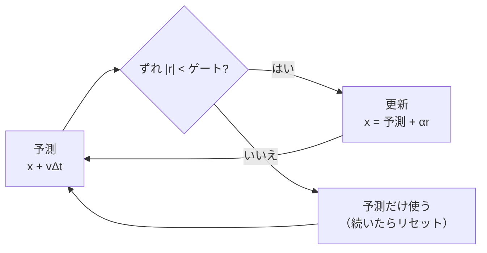

# 7-4 追跡と自己位置：時間と場所を使う

## ねらい

- 1 回ごとの推定を、**前の時刻の推定とつなげて** なめらかにできる（α-β フィルタ）
- 反射などの「とんでもない値」を、**ゲート** ではじけるようになる
- カメラで見たゴールの柱から、**自分がコートのどこにいるか** を計算できる

---

## 理論 1：ボールは瞬間移動しない

これまでのモデルは、**その瞬間のセンサの値だけ** を見て答えていました。でも本物のボールは、50 ms でいきなり 120° 反対側へ動いたりしません。

- 角度が急に大きく変わった → たぶん **反射** か **ほかの赤外線**
- 1 回だけ値が来なかった → たぶん **読み取り失敗**、ボールはさっきの近くにある

この「前の時刻の答え」と「ボールの動きの速さ」を使って、推定をなめらかにするのが **追跡**（tracking）です。

## 理論 2：α-β フィルタ

いちばん簡単な追跡の方法が **α-β フィルタ** です。角度 $x$ と、角度の変わる速さ $v$ を覚えておき、毎回つぎの 3 つをします。

1. **予測**：$\hat x = x + v\,\Delta t$（今の速さのまま動いたら、どこにあるはずか）
2. **ずれ**：$r = z - \hat x$（測った値 $z$ と予測の差）
3. **更新**：$x = \hat x + \alpha r$、　$v = v + \beta\, r / \Delta t$

$\alpha$ が大きいほど測った値を信じ、小さいほど予測を信じます。さらに、

- **ゲート**：$|r|$ が大きすぎる（例：40° 以上）ときは、測った値を使わず予測だけにする
- **リセット**：ゲートで何回も続けてはじいたら、ボールが本当に動いたと考えて、測った値から始め直す



---

## 手を動かす 1：α-β フィルタを作る

```python
import numpy as np
from rcjml.sim.field import chase_rule, rel_ball, goal_angle, new_episode, step

def wrap(a):
    return (a + 180) % 360 - 180

class AlphaBeta:
    def __init__(self, alpha=0.5, beta=0.1, gate=40.0, dt=0.05, max_miss=3):
        self.alpha, self.beta, self.gate, self.dt, self.max_miss = alpha, beta, gate, dt, max_miss
        self.x, self.v, self.miss = None, 0.0, 0

    def update(self, z):
        """z は測った角度（来なかったら None）。追跡した角度を返す。"""
        if self.x is None:                  # まだ一度も見ていない
            if z is not None:
                self.x = z
            return self.x
        pred = wrap(self.x + self.v * self.dt)
        if z is not None and abs(wrap(z - pred)) < self.gate:
            r = wrap(z - pred)
            self.x = wrap(pred + self.alpha * r)
            self.v += self.beta * r / self.dt
            self.miss = 0
        else:                               # 来なかった、またはゲートの外
            self.x, self.v = pred, self.v * 0.9
            self.miss += 1
            if z is not None and self.miss > self.max_miss:
                self.x, self.v, self.miss = z, 0.0, 0     # リセット
        return self.x
```

## 手を動かす 2：にせ物の混じった測定で比べる

5-5 の 2 次元コートでロボットを走らせ、ボールの角度を「測った」値を作ります。

- ふつうのばらつき：±8°
- 8% の確率で、反射などで 60〜150° ずれた値
- 15% の確率で、値が来ない

```python
def run(make_filter=None, n=200, seed=0, sigma=8, p_out=0.08, p_drop=0.15):
    rng = np.random.default_rng(seed)
    errors = []
    for _ in range(n):
        ep = new_episode(rng)
        f = make_filter() if make_filter else None
        last = None
        for t in range(400):
            a, d = rel_ball(ep.robot, ep.ball)
            if rng.random() < p_drop:
                z = None
            else:
                z = a + rng.normal(0, sigma)
                if rng.random() < p_out:
                    z += rng.choice([-1, 1]) * rng.uniform(60, 150)
                z = wrap(z)
            if f:
                est = f.update(z)
            else:                          # フィルタなし：来なかったら前の値
                est = z if z is not None else last
                last = est
            if est is None:
                est = 0.0
            if not ep.holding:
                errors.append(abs(wrap(est - a)))
            step(ep, *chase_rule(a, d, ep.holding, goal_angle(ep.robot)))
            if ep.goal or ep.out:
                break
    e = np.array(errors)
    return e.mean(), np.percentile(e, 95)

for name, mk in [("フィルタなし", None),
                 ("α-β（ゲートなし）", lambda: AlphaBeta(gate=999)),
                 ("α-β（ゲート＋リセット）", lambda: AlphaBeta()),
                 ("α-β α=0.3", lambda: AlphaBeta(alpha=0.3, beta=0.05)),
                 ("α-β α=0.7", lambda: AlphaBeta(alpha=0.7, beta=0.2))]:
    mae, p95 = run(mk)
    print(f"{name:18s} 平均のずれ {mae:5.1f}°   悪いほうから 5% {p95:5.1f}°")
```

| 方法 | 平均のずれ | 悪いほうから 5% のずれ |
|---|---|---|
| フィルタなし | 14.9° | 97.9° |
| α-β（ゲートなし） | 13.3° | 56.4° |
| **α-β（ゲート＋リセット）** | **7.3°** | **14.9°** |
| α-β、α = 0.3 | 7.6° | 18.5° |
| α-β、α = 0.7 | 7.9° | 15.8° |

- ゲートがないと、とんでもない値に引っぱられます。**追跡でいちばん効くのはゲート** です。
- α は小さすぎると動きに遅れ、大きすぎるとばらつきが残ります。

!!! example "やってみよう"
    ゲートを 40° から 20°、80° にかえてみましょう。`max_miss`（リセットまでの回数）を 0 や 10 にするとどうなるでしょう。ロボットがボールのすぐ近くにいるときは、ボールの角度が速く変わることに注意します。

---

## 理論 3：自己位置：自分はコートのどこにいるか

ロボットの向きがわかっていれば（ジャイロやコンパスで、いつも相手ゴールの方を向くようにしている場合）、カメラで見た **相手ゴールの左右の柱の角度** から、自分の位置を計算できます。

柱の位置はわかっているので、「左の柱は角度 $\theta_1$ の方向」「右の柱は $\theta_2$ の方向」という 2 本の線を引くと、その **交わるところ** に自分がいます。

## 手を動かす 3：柱の角度から位置を出す

```python
from rcjml.sim.field import FIELD_H, GOAL_W

POSTS = np.array([[-GOAL_W / 2, FIELD_H / 2], [GOAL_W / 2, FIELD_H / 2]])   # 相手ゴールの左右の柱

def unit(theta_deg):
    t = np.deg2rad(theta_deg)
    return np.array([-np.sin(t), np.cos(t)])       # 正面 0°、左 +（1-4 の決まり）

def locate(a_left, a_right):
    """左右の柱が見える角度から、ロボットの位置 (x, y) を求める。"""
    u1, u2 = unit(a_left), unit(a_right)
    # 柱0 - t1・u1 = 柱1 - t2・u2 を t1, t2 について解く
    t1, t2 = np.linalg.solve(np.column_stack([-u1, u2]), POSTS[1] - POSTS[0])
    return POSTS[0] - t1 * u1

robot = np.array([20.0, -30.0])
print(locate(rel_ball(robot, POSTS[0])[0], rel_ball(robot, POSTS[1])[0]))   # → [ 20. -30.]

rng = np.random.default_rng(0)
err, far = [], []
for _ in range(2000):
    r = np.array([rng.uniform(-80, 80), rng.uniform(-110, 90)])
    al = rel_ball(r, POSTS[0])[0] + rng.normal(0, 1.5)      # カメラのずれ ±1.5°
    ar = rel_ball(r, POSTS[1])[0] + rng.normal(0, 1.5)
    err.append(np.linalg.norm(locate(al, ar) - r))
    far.append(FIELD_H / 2 - r[1])
err, far = np.array(err), np.array(far)
print(f"位置のずれ（中央値）: 全体 {np.median(err):.1f} cm、"
      f"ゴールに近い（80 cm 未満）{np.median(err[far < 80]):.1f} cm、遠い（160 cm 以上）{np.median(err[far > 160]):.1f} cm")
```

| ゴールまでの距離 | 位置のずれ（中央値） |
|---|---|
| 80 cm 未満 | 3.2 cm |
| 全体 | 8.0 cm |
| 160 cm 以上 | 19.0 cm |

遠くからだと 2 本の柱がほとんど同じ方向に見えるので、少しの角度のずれで位置が大きくずれます。遠いときは、**自分のゴールの柱**（後ろ向きのカメラや、ロボットを回したとき）や、**白線**、**かべまでの距離**（超音波・ToF センサ）と組み合わせます。

!!! tip "自分の位置がわかると"
    - ボールを持ったとき、ゴールの **空いているほう** をねらえる（6-9）
    - ボールが見えないとき、守りの位置へ戻れる（7-2）
    - コートの外に出そうなとき、手前で止まれる

---

## チェック問題

1. α-β フィルタの α を 1 にすると、どうなりますか。
2. ゲートがないと、反射の値が来たときに何が起きますか。
3. ゴールの柱から自分の位置を出すとき、遠いほど不正確になるのはなぜですか。

??? note "答え"
    1. 測った値をそのまま使うことになり、フィルタなしとほぼ同じになります。
    2. 推定がにせ物の方向へ大きく引っぱられ、しかも速さ $v$ も狂うので、しばらく元に戻りません。
    3. 2 本の柱がほとんど同じ方向に見え、2 本の線が浅い角度で交わるからです。角度が少しずれるだけで、交わる場所が大きく動きます。

## つまずきポイント

??? failure "フィルタを入れたら、ボールに追いつけなくなった"
    α が小さすぎるか、ゲートが狭すぎて、本当の動きまではじいています。ロボットがボールの近くにいるときは、角度が速く変わります。近いときだけゲートを広げる、という工夫もあります。

??? failure "自分の位置がときどき大きく飛ぶ"
    柱をまちがえて見つけている（ロボットや観客を柱だと思った）かもしれません。位置にも α-β フィルタやゲートを使います。

## もっと深く

!!! deeper "カルマンフィルタ、パーティクルフィルタ、SLAM"
    α-β フィルタは、α と β を固定した **カルマンフィルタ** と考えられます。カルマンフィルタは、ずれの大きさ（共分散）を毎回計算して、α・β にあたる値を自動で決めます。
    自己位置推定でよく使われるのは **パーティクルフィルタ**（モンテカルロ位置推定）です。「ここにいるかも」という点をたくさんばらまき、センサの値に合う点を残していきます。白線やゴールの見え方、オドメトリ（車輪の回転）を組み合わせられます。
    地図も同時に作る方法を **SLAM** と呼びます。ロボカップの上のリーグ（ヒューマノイド、中型）では、こうした方法が使われています。
